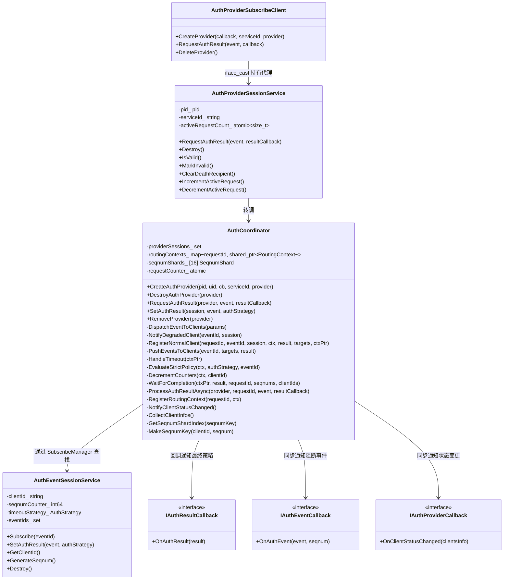
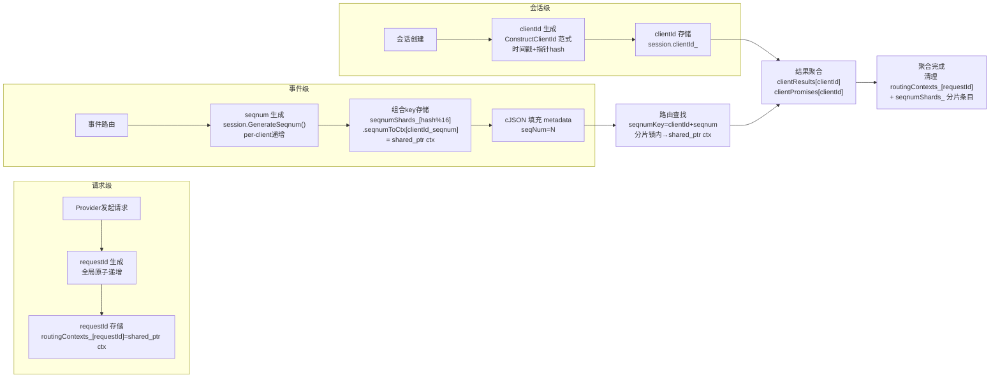
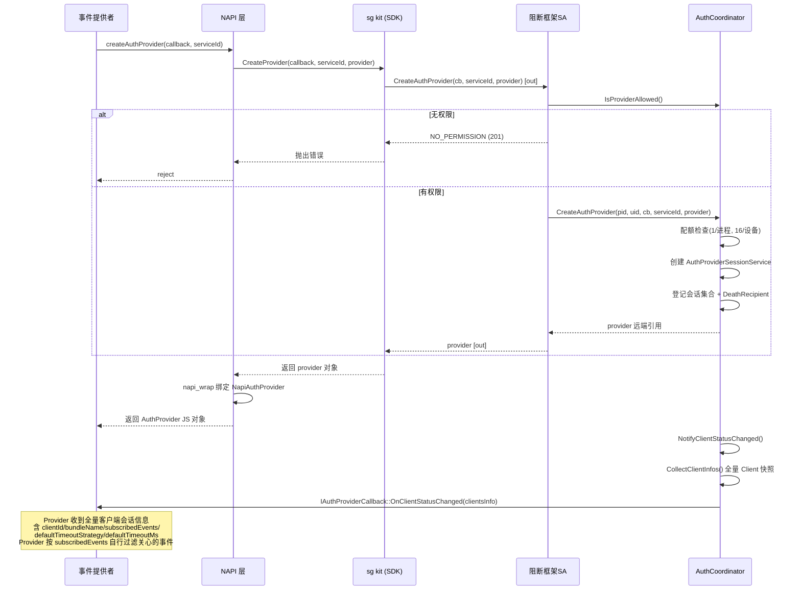
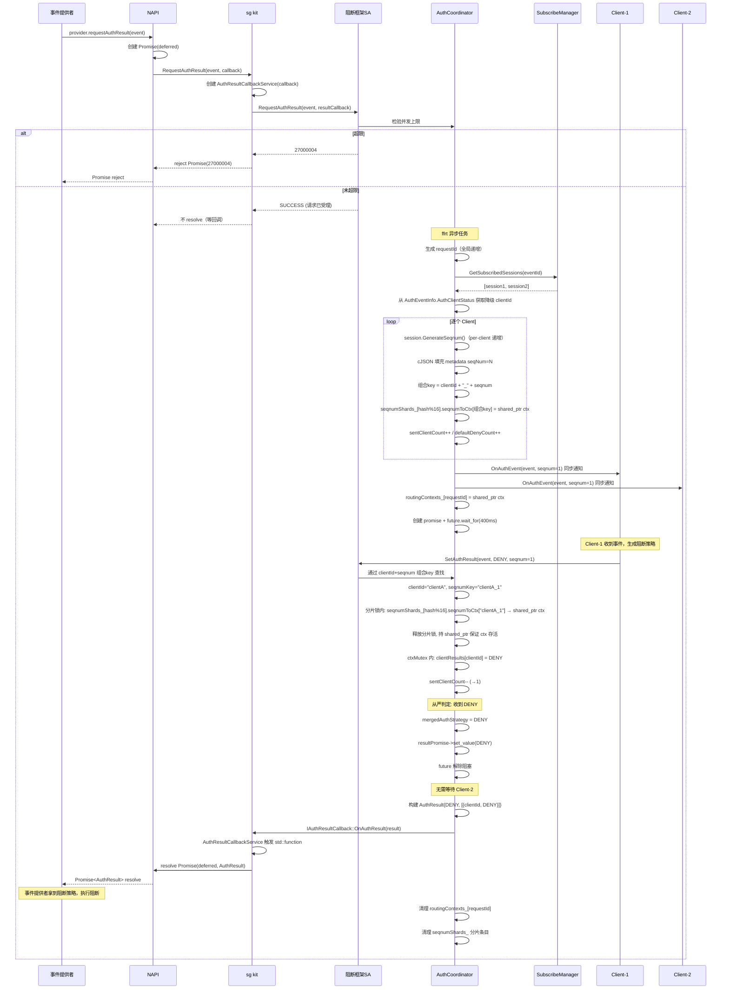
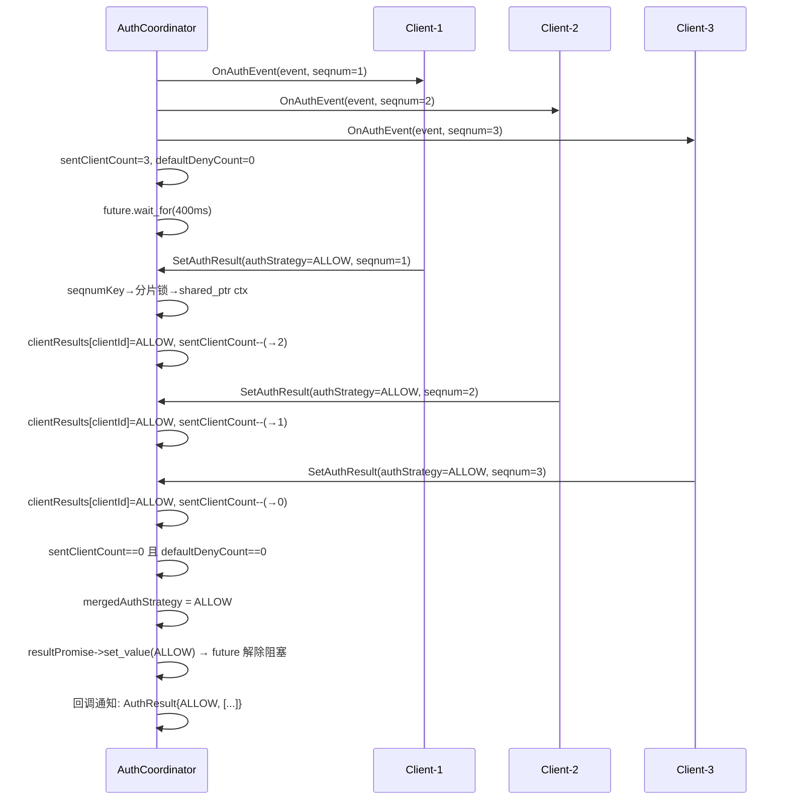
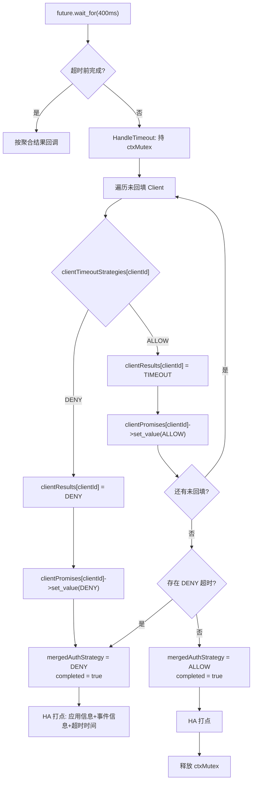
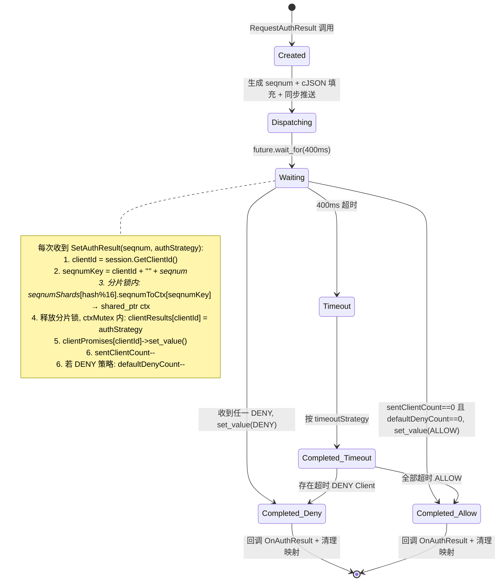
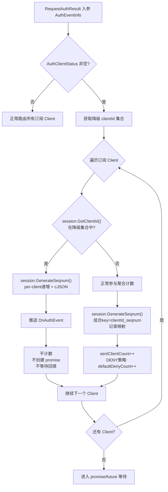
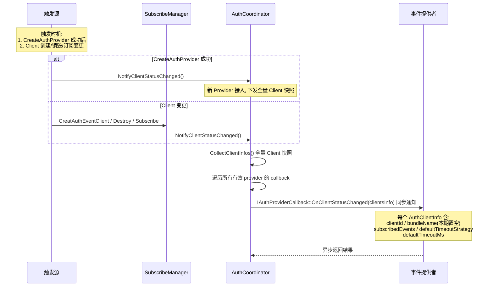
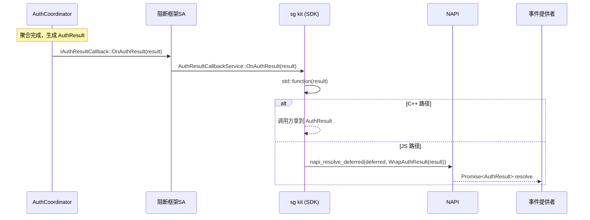

# 阻断框架协调者模块设计文档

> SR-20260806903302 · 支持阻断服务者接入阻断框架
> 状态：已实现并编译通过

## 1. 概述

### 1.1 背景

security_guard 仓库已合入 AuthClient 消费者侧框架（SR20260806903405），提供客户端会话管理、事件订阅与结果回填能力，但缺少事件路由聚合与 Provider 侧接入。本设计新增**协调者模块（AuthCoordinator）**，承接 Provider 会话管理、事件路由、从严聚合与策略回调转发，与消费者侧框架共同构成完整的阻断框架。

### 1.2 目标

- Provider 通过 `CreateAuthProvider` 接入框架，同步验证权限，异步返回会话标识
- Provider 调 `RequestAuthResult` 请求鉴权结果，IPC 异步返回受理码，最终结果经回调通知 Promise
- Client 回填阻断/放行结果，框架按**从严策略**（任一阻断即阻断，全部放行才放行）聚合
- 超时 400ms 未回填的 Client 按其 `timeoutStrategy` 处置
- SA 聚合完成后经 `IAuthResultCallback` 回调通知 kit → kit 触发 `Promise<AuthResult>`
- 新增 `ohos.permission.AUTH_SERVICE_ACCESS` 权限校验

### 1.3 约束

| 项目 | 约束 |
|---|---|
| 部署位置 | SA 3524（data_collect）同进程 |
| Provider 配额 | 1/进程，16/设备 |
| 并发请求 | 128/Provider（per-provider 计数，超限返回 27000004） |
| Client 配额 | 2/进程，16/设备（复用现有） |
| 超时时间 | SA 侧硬编码 400ms；kit 侧 promise/future.wait_for(400ms) 同步等待 |
| 等待机制 | SA: std::promise/std::future；kit: promise/future 同步转异步 |
| 路由索引 | seqnumKey(clientId+"_"+seqnum) → shared_ptr<RoutingContext>（分片存储，一级查找） |
| 降级来源 | 从 `AuthEventInfo.AuthClientStatus` 入参获取 |
| metadata 序列化 | cJSON |
| 锁约束 | ffrt 任务中用 ffrt 锁，不混用 std mutex |
| 方法入参 | ≤5 |
| 函数行数 | ≤50 |
| 嵌套深度 | ≤5 |
| feature flag | `security_guard_auth_event_enable`（默认 false） |
| 编译条件 | 仅 PC（`security_guard_device_type == "pc"`） |
| 权限 | `ohos.permission.AUTH_SERVICE_ACCESS`（定义在 access_token 部件仓） |

## 2. 模块架构



### 2.1 模块职责

| 模块 | 职责 | 位置 |
|---|---|---|
| AuthProviderSubscribeClient | Provider 侧 SDK，创建会话、请求结果、死亡重连 | `frameworks/common/collect/src/` |
| AuthProviderSessionService | Provider 服务端会话对象，方案 D「会话即远端对象」 | `services/data_collect/sa/` |
| AuthCoordinator | 核心协调者，事件路由 + 从严聚合 + 超时 + 状态通知 | `services/data_collect/sa/` |
| AuthEventSessionService | Client 服务端会话对象，持有 clientId | `services/data_collect/sa/` |
| AuthResultCallbackService | 回调 stub，包装 std::function，SA 聚合完成后触发 | `frameworks/common/collect/src/` |

### 2.2 三层标识体系



| 标识 | 生成方式 | 用途 | 生命周期 | 唯一性 |
|---|---|---|---|---|
| clientId | `ConstructClientId` 范式（时间戳 + 指针 hash） | 结果聚合、状态通知、结果返回 | 会话级 | 全局唯一 |
| requestId | 全局原子递增 | 隔离同一 eventId 的多次请求（高频并发） | 请求级（400ms） | 全局唯一 |
| seqnum | `session->GenerateSeqnum()` per-client 递增 | 路由查找（组合 key → requestId → ctx） | 事件级 | **per-client 唯一**，不同客户端可能相同 |

**组合 key 策略**：seqnum per-client 递增，不同客户端可能产生相同值。用 `clientId + "_" + seqnum` 组合作为 `seqnumShards_[hash(key)%16].seqnumToCtx` 的 key，避免冲突。分片存储降低高并发下锁竞争（P1-3）。

## 3. 核心流程

### 3.1 Provider 创建会话（异步返回）



### 3.2 事件路由与从严聚合（完整链路）



### 3.3 全部放行场景



### 3.4 超时处置流程



> 注：HandleTimeout 全程持 `ctxMutex`，与 SetAuthResult 互斥访问 ctx 字段（P0-2 修复）。

### 3.5 路由上下文状态图



### 3.6 降级客户端处理流程



### 3.7 Client 状态通知流程



### 3.8 回调链路（SA → kit → Promise）



## 4. 接口定义

### 4.1 主接口 IDL（DataCollectManagerIdl.idl）

```idl
void CreateAuthProvider([in] IRemoteObject cb, [in] String serviceId, [out] IRemoteObject provider);
void CreatAuthEventClient([in] IRemoteObject cb, [in] int timeoutAllowFlag, [out] IRemoteObject session);
```

### 4.2 Provider 会话 IDL（AuthProviderSession.idl）

```idl
// 返回码为请求受理结果，最终策略经 resultCallback 回调返回
void RequestAuthResult([in] AuthEventInfo event, [in] IRemoteObject resultCallback);
void Destroy();
```

### 4.3 Client 会话 IDL（AuthEventSession.idl）

```idl
void Subscribe([in] long eventId);
void Unsubscribe([in] long eventId);
void SetAuthResult([in] AuthEvent event, [in] boolean allowFlag);
void Destroy();
```

### 4.4 回调接口

| 回调 | 方法 | 触发时机 | 方向 |
|---|---|---|---|
| IAuthEventCallback | `OnAuthEvent(event, seqnum)` | SA 向 Client 推送阻断事件 | SA → Client 同步 |
| IAuthProviderCallback | `OnClientStatusChanged(clientsInfo)` | Client 状态变化 | SA → Provider 同步 |
| IAuthResultCallback | `OnAuthResult(result)` | 聚合完成 | SA → kit 回调（触发 Promise） |

### 4.5 NAPI 层

| 函数 | 类型 | 说明 |
|---|---|---|
| `createAuthProvider(callback, serviceId)` | 模块级 | 返回 AuthProvider JS 对象 |
| `destroyAuthProvider(provider)` | 模块级 | 返回 void |
| `provider.requestAuthResult(event)` | 对象方法 | 返回 Promise<AuthResult> |

## 5. 数据结构

### 5.1 AuthEvent（新增 seqnum）

```cpp
class AuthEvent : public Parcelable {
    int64_t eventId_;    // 事件标识
    int64_t seqnum_;     // 事件唯一序号（每客户端每事件独有）
    std::string content_;
    std::string metadata_; // cJSON 序列化 seqNum=N
};
```

### 5.2 核心内部结构

```cpp
struct RoutingContext {
    int64_t eventId;
    std::string eventContent;      // 原始事件内容, 供超时 HA 打点
    std::string eventMetadata;      // 原始事件 metadata, 供超时 HA 打点
    size_t sentClientCount;                    // 待回填计数
    size_t defaultDenyCount;                   // 默认阻断计数
    map<string, AuthStrategy> clientResults;   // clientId → 回填策略
    map<string, AuthStrategy> clientTimeoutStrategies; // clientId → 超时策略
    map<string, shared_ptr<promise<AuthStrategy>>> clientPromises; // clientId → promise
    struct ClientAppInfo { pid_t pid; int32_t uid; };
    map<string, ClientAppInfo> clientAppInfos; // clientId → pid/uid, 供超时 HA 打点
    shared_ptr<promise<AuthResult>> resultPromise; // 最终结果 promise
    ffrt::mutex ctxMutex;                       // per-request 锁, 保护字段修改
    bool completed;
    AuthStrategy mergedAuthStrategy;
};

// 按 requestId 索引（隔离同一 eventId 的高频并发请求）
// shared_ptr: SetAuthResult 持拷贝延长生命周期, 避免 erase 后 UAF (P0-1)
map<int64_t, shared_ptr<RoutingContext>> routingContexts_;

// seqnum per-client 递增，用 clientId+seqnum 组合 key 避免冲突
// 分片存储降低高并发下锁竞争 (P1-3)
constexpr size_t SEQNUM_SHARD_COUNT = 16;
struct SeqnumShard {
    ffrt::mutex mutex;
    map<string, shared_ptr<RoutingContext>> seqnumToCtx;  // clientId_seqnum → ctx
};
SeqnumShard seqnumShards_[SEQNUM_SHARD_COUNT];

atomic<int64_t> requestCounter_ {0};  // requestId 全局递增

// Provider 会话管理
class AuthProviderSessionService : public AuthProviderSessionStub, public NoCopyable {
    atomic<size_t> activeRequestCount_ {0};  // per-provider 并发计数 (上限 128)
    void ClearDeathRecipient();  // 断开与 DeathRecipient 的循环引用 (P1-1)
};
```

### 5.3 clientId 生成

```cpp
// 对齐 ConstructClientId 范式（时间戳 + 指针 hash）
std::string timeStr = std::to_string(std::chrono::steady_clock::now().time_since_epoch().count());
std::string ptrStr = std::to_string(reinterpret_cast<int64_t>(callback.GetRefPtr()));
clientId_ = std::to_string(std::hash<std::string>{}(timeStr + ptrStr));
```

### 5.4 seqnum per-client 递增

```cpp
// AuthEventSessionService 内 per-client 计数器
int64_t GenerateSeqnum() { return ++seqnumCounter_; }

// 组合 key 工具函数
static std::string MakeSeqnumKey(const std::string &clientId, int64_t seqnum) {
    return clientId + "_" + std::to_string(seqnum);
}
```

### 5.4 metadata cJSON 序列化

```c
cJSON *root = cJSON_CreateObject();
cJSON_AddNumberToObject(root, "seqNum", (double)seqnum);
char *jsonStr = cJSON_PrintUnformatted(root);
event.SetMetadata(jsonStr);
cJSON_free(jsonStr);
cJSON_Delete(root);
```

## 6. 从严聚合算法

```
输入：eventId, AuthEventInfo.AuthClientStatus[], 已订阅 Client 列表
输出：AuthResult{mergedAuthStrategy, clientAuthResult[]}

0. 生成 requestId（全局递增，隔离同一 eventId 的并发请求）
   创建 shared_ptr<RoutingContext> ctxPtr（生命周期由 shared_ptr 管理）

1. 从入参 AuthClientStatus 获取降级 clientId 集合

2. 遍历订阅 Client:
   clientId = session.GetClientId()
   IF clientId 在降级集合中:
     seqnum = session.GenerateSeqnum()（per-client 递增）
     cJSON 填充 metadata, 推送 OnAuthEvent, 不计数, 跳过
   ELSE:
     seqnum = session.GenerateSeqnum()（per-client 递增）
     cJSON 填充 metadata
     seqnumKey = clientId + "_" + seqnum（组合 key 避免冲突）
     shardIdx = hash(seqnumKey) % 16
     分片锁内: seqnumShards_[shardIdx].seqnumToCtx[seqnumKey] = ctxPtr
     ctxPtr->sentClientCount++
     IF timeoutStrategy==DENY: ctxPtr->defaultDenyCount++

3. 推送 OnAuthEvent 给所有 Client（含降级）

4. 注册 RoutingContext 到 routingContexts_[requestId] = ctxPtr
   创建 promise<AuthResult>, future.wait_for(400ms)

5. 每次收到 SetAuthResult(seqnum, authStrategy):
   clientId = session.GetClientId()
   seqnumKey = clientId + "_" + seqnum
   shardIdx = hash(seqnumKey) % 16
   分片锁内: seqnumShards_[shardIdx].seqnumToCtx[seqnumKey] → 拷贝 shared_ptr ctx
   释放分片锁
   ctxMutex 内:
     IF ctx.completed: return SUCCESS
     clientResults[clientId] = authStrategy
     clientPromises[clientId]->set_value(authStrategy)
     sentClientCount--
     IF clientTimeoutStrategies[clientId]==DENY: defaultDenyCount--

     IF authStrategy == DENY:
       mergedAuthStrategy = DENY, completed = true → resultPromise->set_value(DENY)
     ELIF sentClientCount==0 且 defaultDenyCount==0:
       mergedAuthStrategy = ALLOW, completed = true → resultPromise->set_value(ALLOW)

6. 超时(future 超时):
   HandleTimeout: 持 ctxMutex, 遍历未回填 clientId:
     按 timeoutStrategy:
       DENY → clientResults=DENY, mergedAuthStrategy=DENY, completed=true
       ALLOW → clientResults=TIMEOUT
   HA 打点

7. 构建 AuthResult, OnAuthResult 回调通知 kit → Promise resolve
8. 清理: routingContexts_.erase(requestId) + seqnumShards_ 分片条目 erase
   shared_ptr 引用计数归零后 ctx 析构
```

## 7. 编译配置

```gn
# security_guard.gni（复用）
security_guard_auth_event_enable = false  # 默认关闭

# services/data_collect/BUILD.gn
if (security_guard_auth_event_enable) {
    defines += [ "SECURITY_GUARD_AUTH_EVENT_ENABLE" ]
    sources += [ "sa/auth_coordinator.cpp", "sa/auth_provider_session_service.cpp", ... ]
    deps += [ ":auth_provider_session_sa_stub" ]
}
external_deps += [ "cJSON:cjson" ]  # cJSON 依赖

# frameworks/js/napi/BUILD.gn
if (security_guard_auth_event_enable) {
    defines += [ "SECURITY_GUARD_AUTH_EVENT_ENABLE" ]
    sources += [ "napi_block_framework.cpp" ]
}
```

## 8. 权限校验

| 角色 | 权限 | 校验方式 |
|---|---|---|
| Provider | `ohos.permission.AUTH_SERVICE_ACCESS` | HAP: VerifyAccessToken；native: uid 白名单 |
| Client | `ohos.permission.kernel.AUTH_AUDIT_EVENT` | HAP: VerifyAccessToken；native: uid 白名单（不变） |

## 9. 错误码

| 错误码 | 常量名 | 含义 | JS 映射 |
|---|---|---|---|
| 201 | JS_ERR_NO_PERMISSION | 鉴权失败 | 已存在 |
| 202 | JS_ERR_NO_SYSTEMCALL | 非系统应用 | 已存在 |
| 27000001 | AUTH_PROVIDER_INTERNAL_ERROR | 内部错误 | 新增 |
| 27000002 | AUTH_PROVIDER_EXCEED_PROCESS_LIMIT | Provider 进程超限 | 新增 |
| 27000003 | AUTH_PROVIDER_EXCEED_GLOBAL_LIMIT | Provider 全局超限 | 新增 |
| 27000004 | AUTH_REQUEST_EXCEED_LIMIT | 单 Provider 并发请求超限 | 新增 |

## 10. 文件清单

### 新增文件（35 个）

**inner_api 头文件（13 个）**
- `auth_strategy.h`、`auth_event_info.h`、`auth_client_status.h`、`client_auth_result.h`、`auth_result.h`、`auth_client_info.h`
- `i_auth_provider_callback.h`、`i_auth_result_callback.h`
- `auth_provider_callback_stub.h`、`auth_provider_callback_service.h`
- `auth_result_callback_stub.h`、`auth_result_callback_service.h`
- `auth_provider_subscribe_client.h`

**IDL（1 个）**：`AuthProviderSession.idl`

**服务端（3 头 + 3 实现）**：`auth_coordinator.h/.cpp`、`auth_provider_session_service.h/.cpp`、`auth_provider_callback_proxy.h/.cpp`

**Parcelable 实现（6 个）**：`auth_event_info.cpp`、`auth_client_status.cpp`、`client_auth_result.cpp`、`auth_result.cpp`、`auth_client_info.cpp`、`auth_event.cpp`（修改）

**SDK 实现（5 个）**：`auth_provider_callback_service.cpp`、`auth_provider_callback_stub.cpp`、`auth_provider_subscribe_client.cpp`、`auth_result_callback_stub.cpp`、`auth_result_callback_service.cpp`

**NAPI（2 个）**：`napi_block_framework.h/.cpp`

**测试（2 个）**：`auth_coordinator_test.cpp`、`auth_provider_session_service_test.cpp`

### 修改文件（25+ 个）

- IDL、接口码、回调、SDK、服务端、构建配置、错误码、NAPI 注册等（详见 dev-design.md §5）

## 11. 验收标准

| # | 验收项 |
|---|---|
| 1 | 无权限返回 201 |
| 2 | 非系统应用返回 202 |
| 3 | 内部错误返回 27000001 |
| 4 | Provider 进程超限返回 27000002 |
| 5 | Provider 全局超限返回 27000003 |
| 6 | 单 Provider 并发请求超限返回 27000004 |
| 7 | CreateAuthProvider 异步返回会话标识 |
| 8 | RequestAuthResult IPC 异步返回，最终结果经回调通知 Promise |
| 9 | 每个 Client 收到 per-client seqnum，metadata 含 cJSON `seqNum=N` |
| 10 | clientId 按 ConstructClientId 范式生成 |
| 11 | SA 通过 clientId+seqnum 组合 key → 分片查找 → shared_ptr<RoutingContext> 路由（一级查找） |
| 12 | 双计数正确递减 |
| 13 | 从严策略：任一 DENY 立即阻断 |
| 14 | 从严策略：全部 ALLOW 才放行 |
| 15 | 超时 DENY 触发阻断 |
| 16 | 超时 ALLOW 不阻断 |
| 17 | 降级 Client 只通知不参与聚合 |
| 18 | 无订阅 Client 默认放行 |
| 19 | 聚合完成后清理 routingContexts_[requestId] + seqnumShards_ 分片条目 |
| 20 | 回调链路：SA → IAuthResultCallback → kit → Promise resolve |
| 21 | Client 状态变更通知 Provider；CreateAuthProvider 成功后通过 IAuthProviderCallback::OnClientStatusChanged 下发全量客户端会话信息 |
| 22 | Destroy 幂等 |
| 23 | feature flag 关闭时占位返回 FAILED |
| 24 | ffrt 锁不混用 std mutex |
| 25 | 方法入参 ≤5，函数行数 ≤50，嵌套 ≤5 |
| 26 | 超时 ALLOW 客户端 clientAuthResult 为 TIMEOUT |
| 27 | Client 回填结果经 SubscribeManager 锁外转发到 Coordinator 驱动聚合 |
| 28 | SetAuthResult 分片锁内查找 + ctxMutex 内修改字段，无 UAF（P0-1） |
| 29 | HandleTimeout 全程持 ctxMutex，与 SetAuthResult 互斥（P0-2） |
| 30 | ProcessAuthResultAsync 捕获 sptr<AuthProviderSessionService>，无裸指针 UAF（P0-3） |
| 31 | DestroyAuthProvider/RemoveProvider 调 ClearDeathRecipient 断循环引用，无内存泄漏（P1-1） |

## 12. 可靠性设计

### 12.1 进程崩溃

| 场景 | 处置 |
|---|---|
| 订阅者崩溃 | DeathRecipient 清理会话，异步通知 Provider 状态变更；订阅者 SDK 退避重连重建会话并重新订阅 |
| Provider 崩溃 | DeathRecipient 清理会话，异步通知其他 Provider 状态变更；Provider SDK 退避重连 `{1,5,15,30,60…}` 秒后重新 `CreateAuthProvider` 注册，SA 自动 `NotifyClientStatusChanged` 下发全量客户端列表 |
| SG 崩溃 | 订阅者 SDK 与 Provider SDK 均通过 `DeathRecipient` 感知，退避重连 `{1,5,15,30,60…}` 秒后重建会话/重新注册 |

### 12.2 线程死锁

- `AuthEventSubscribeManager::SetAuthResult` 锁内存表，锁外转发到 `AuthCoordinator::SetAuthResult`，避免 `SubscribeManager mutex → Coordinator mutex → ctxMutex` 嵌套持锁
- M11: `RequestAuthResult` IPC 立即返回受理码，dispatch + register + wait + notify + cleanup 全部在 `ProcessAuthResultAsync` 的 ffrt 异步任务中执行，不阻塞 SA IPC 线程
- kit 侧 `RequestAuthResult` 用 `promise/future` 同步转异步，NAPI 层在 `napi_async_work` worker 线程阻塞等待，不阻塞 JS 主线程
- Provider SDK `OnRemoteDied` 通过 `ffrt::submit` 异步执行退避重连，不阻塞 binder 线程

### 12.3 内存膨胀

- 每 Provider 并发请求上限 128（`MAX_AUTH_REQUEST_CONCURRENT_PER_PROVIDER`），超限返回 `AUTH_REQUEST_EXCEED_LIMIT(27000004)`
- per-provider 原子计数 `activeRequestCount_`，聚合完成/超时后递减

### 12.4 超时

| 层 | 超时时间 | 策略 |
|---|---|---|
| SA 框架 | 400ms（`AUTH_RESULT_TIMEOUT_MS`） | `future.wait_for(400ms)`，超时按各 Client `defaultTimeoutStrategy` 处置：DENY→阻断，ALLOW→记 TIMEOUT |
| kit | 400ms（`AUTH_RESULT_TIMEOUT_MS`） | `future.wait_for(400ms)`，超时返回 `mergedAuthStrategy=TIMEOUT` |

### 12.5 Client 状态通知

`CollectClientInfos` 遍历 `AuthEventSubscribeManager::GetAllSessions()` 全量会话快照，填充 `AuthClientInfo`（含 `clientId`/`bundleName`(本期置空)/`subscribedEvents`/`defaultTimeoutStrategy`/`defaultTimeoutMs`）。`NotifyClientStatusChanged` 遍历所有有效 provider 的 callback，通过 `IAuthProviderCallback::OnClientStatusChanged` 同步通知。

**触发时机**：① `CreateAuthProvider` 成功后（新 Provider 接入，下发全量客户端列表）；② Client 创建/销毁/订阅变更时（状态变化通知所有 Provider）。Provider 可按 `AuthClientInfo.subscribedEvents` 自行过滤关心的事件。

### 12.6 HA 打点

| 场景 | 触发时机 | 打点内容 | 出口 |
|---|---|---|---|
| 阻断结果回填 | Client `SetAuthResult` 且策略为 DENY 时 | 应用信息(pid/uid) + 事件信息(eventId/content/metadata) + 发送时间(sendTimeMs) | `AuthEventReporter::ReportAuthBlockResult` |
| 超时未回填 | SA 400ms 超时，Client 未回填时 | 应用信息(pid/uid) + 事件信息(eventId/content/metadata) + 超时时间(timeoutMs) | `AuthEventReporter::ReportTimeoutResult` |

- 两类打点均经 `AuthEventReporter::ReportToHa` 统一接入 HA lite 客户端（`ha_client_lite_api.h` 依赖进入构建环境后在此函数完成接入）
- RoutingContext 存储原始事件内容(`eventContent`/`eventMetadata`)和 per-client 应用信息(`clientAppInfos`)，供超时打点使用

### 12.7 并发安全与资源释放

**RoutingContext 生命周期（P0-1）**：`routingContexts_` 存 `shared_ptr<RoutingContext>`，`SetAuthResult` 在分片锁内拷贝 `shared_ptr` 后释放分片锁，再用 per-request `ctxMutex` 修改字段。即使 `WaitForCompletion` 已 `erase` map 条目，`SetAuthResult` 持有的 `shared_ptr` 仍保证 ctx 存活到函数结束，消除 UAF。

**HandleTimeout 数据竞争修复（P0-2）**：`HandleTimeout` 全程持 `ctxMutex`，与 `SetAuthResult` 互斥访问 `clientResults`/`completed`/`mergedAuthStrategy` 等字段。`HandleTimeout` 设置 `completed=true` 后，迟到的 `SetAuthResult` 检查 `completed` 直接返回，不再修改字段。

**Provider 生命周期（P0-3）**：`ProcessAuthResultAsync` 捕获 `sptr<AuthProviderSessionService>` 而非裸指针，`RequestAuthResult` 在 `mutex_` 锁内从 `providerSessions_` 查找 sptr 传入。ffrt 任务执行期间 provider 不会被析构，`IsValid()` 检查 + sptr 引用计数双重保证。

**循环引用断开（P1-1）**：`AuthProviderSessionService` 持 `sptr<DeathRecipient>`，`DeathRecipient` 持 `sptr<AuthProviderSessionService>`，形成循环引用。`DestroyAuthProvider` 和 `RemoveProvider` 在清理路径显式调用 `ClearDeathRecipient()` 断开循环，防止内存泄漏。

**分片锁降低竞争（P1-3）**：`seqnumToCtx_` 按 `hash(seqnumKey) % 16` 分片，每分片独立锁。`SetAuthResult` 只锁对应分片（~2μs），替代原全局 `mutex_` 两级查找（~30μs）。20+ Provider × 128 并发场景下锁利用率从 ~19% 降至 ~1.2%。`mutex_` 仍保护 `routingContexts_` 和 `providerSessions_`，但访问频率低。

**锁层次（避免死锁）**：
```
seqnumShard[idx].mutex  →  ctxPtr->ctxMutex     （SetAuthResult: 先分片锁查找，再 ctxMutex 修改）
mutex_                   →  seqnumShard[idx].mutex  （WaitForCompletion: 先 mutex_ erase routingContexts_，再分片锁 erase seqnumToCtx）
```
不存在反向获取顺序，无死锁风险。
