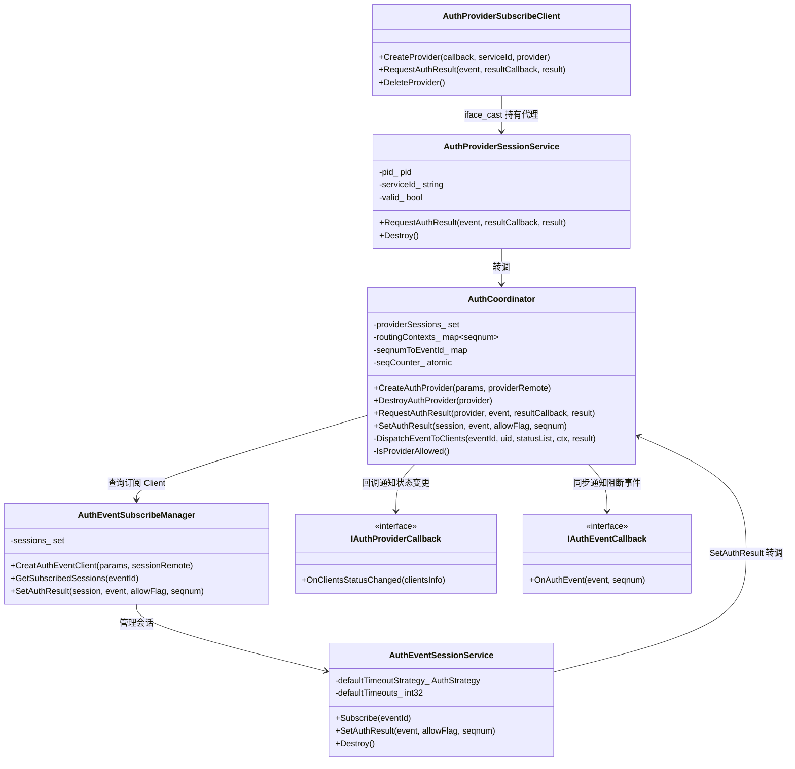
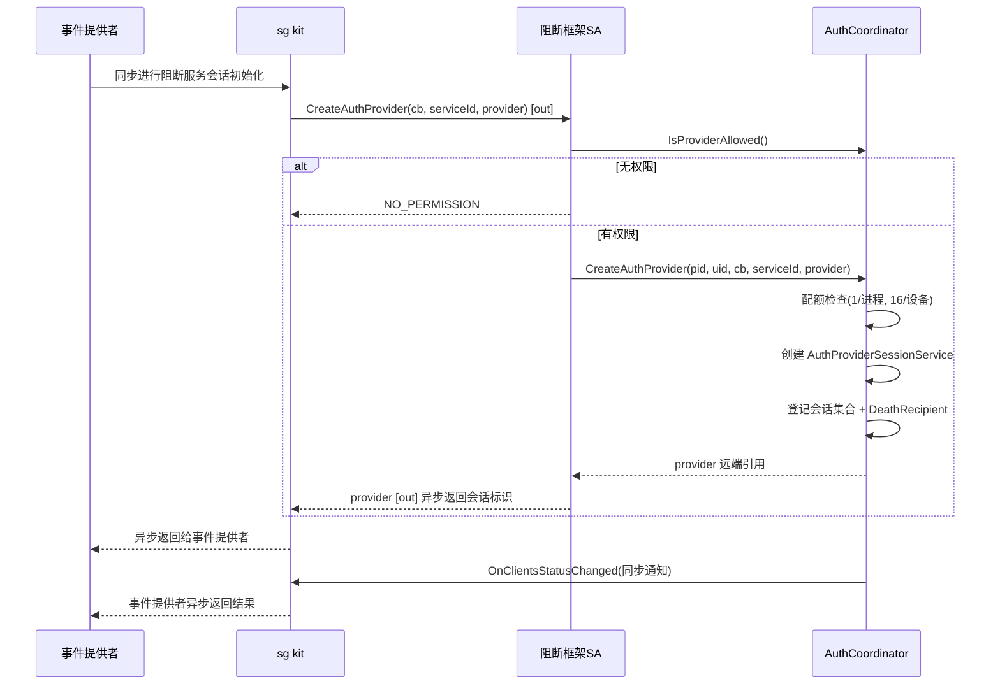
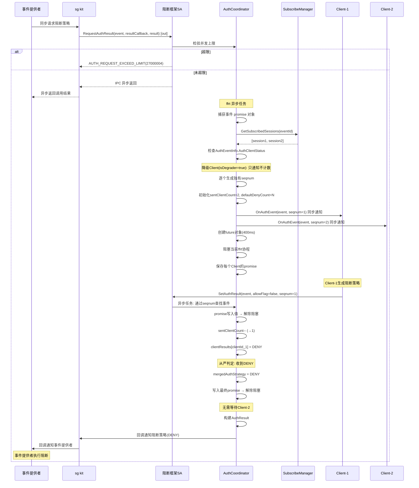
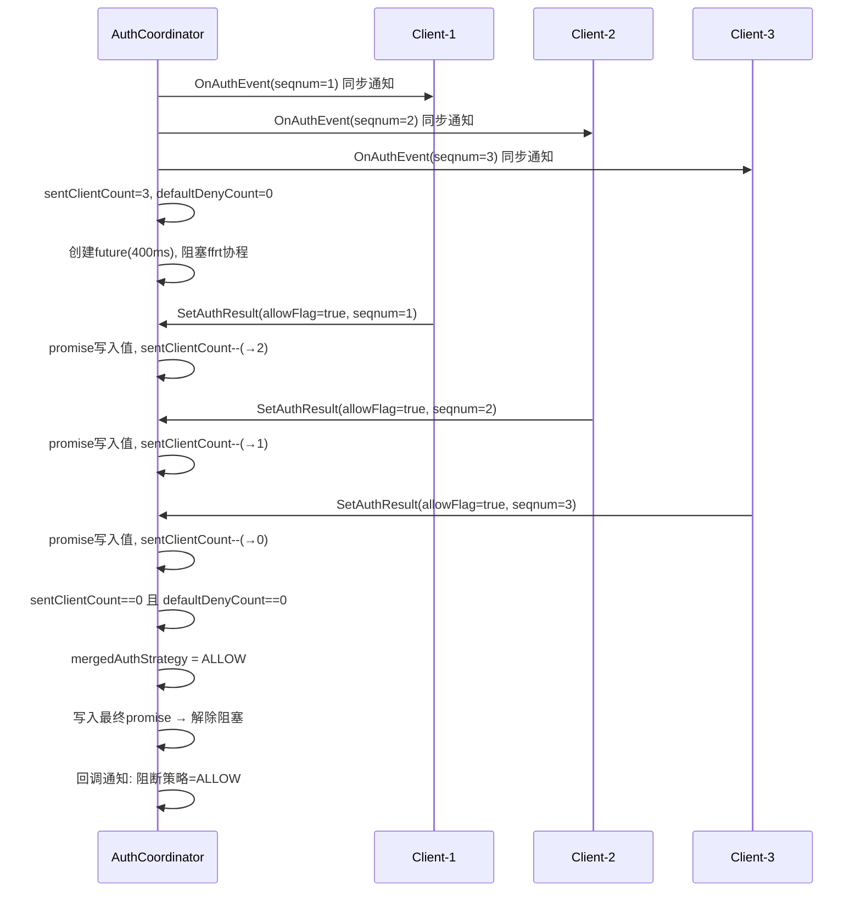
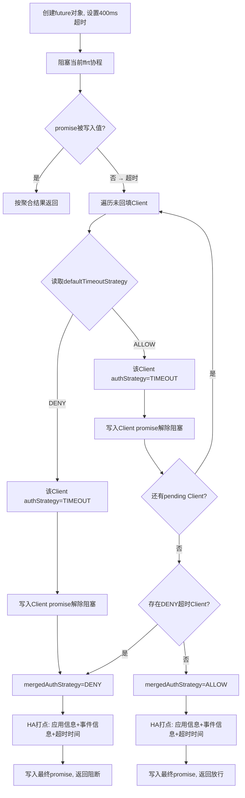
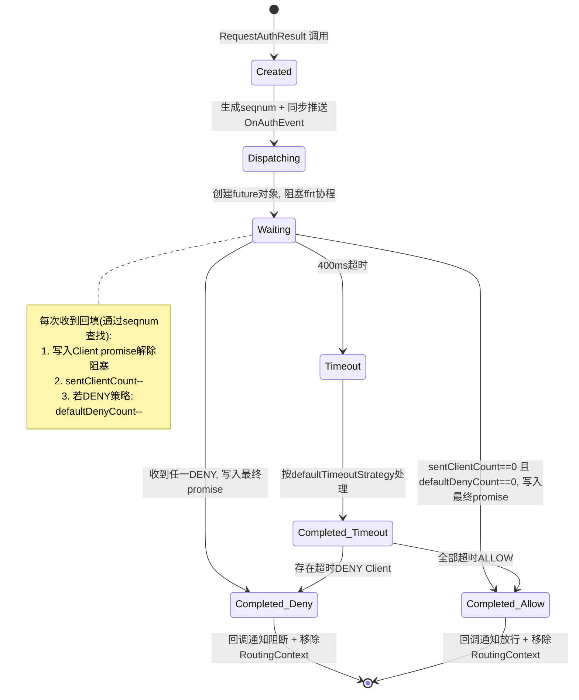
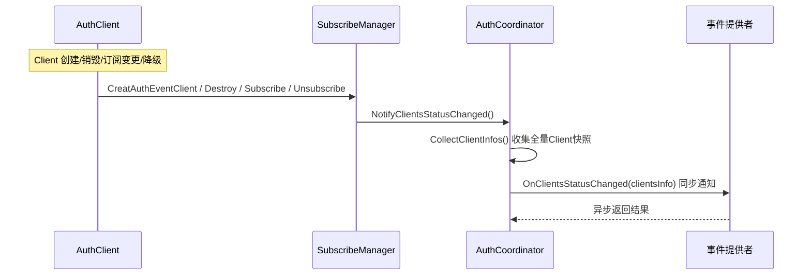
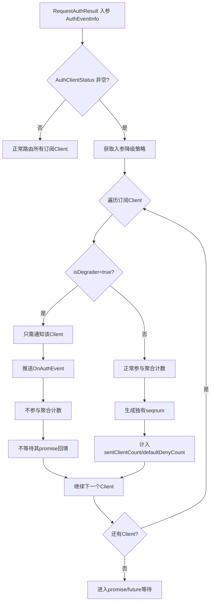

# 阻断框架协调者模块设计文档

> SR-20260806903302 · 支持阻断服务者接入阻断框架
> 状态：已实现（T1–T4 编译通过）

## 1. 概述

### 1.1 背景

security_guard 仓库已合入 AuthClient 消费者侧框架（SR20260806903405），提供客户端会话管理、事件订阅与结果回填能力，但缺少事件路由聚合与 Provider 侧接入。本设计新增**协调者模块（AuthCoordinator）**，承接 Provider 会话管理、事件路由、从严聚合与策略转发，与消费者侧框架共同构成完整的阻断框架。

### 1.2 目标

- Provider 通过 `CreateAuthProvider` 接入框架，接口同步验证权限，异步返回会话标识
- Provider 调 `RequestAuthResult` 请求鉴权结果，IPC 异步返回，最终结果经回调通知
- Client 回填阻断/放行结果，框架按**从严策略**（任一阻断即阻断，全部放行才放行）聚合
- 超时 400ms 未回填的 Client 按其 `defaultTimeoutStrategy` 处置
- 聚合结果经回调通知 sg kit → sg kit 回调通知事件提供者
- 新增 `ohos.permission.AUTH_SERVICE_ACCESS` 权限校验

### 1.3 约束

| 项目 | 约束 |
|---|---|
| 部署位置 | SA 3524（data_collect）同进程 |
| Provider 配额 | 1/进程，16/设备 |
| Client 配额 | 2/进程，16/设备（复用现有） |
| 超时时间 | 硬编码 400ms |
| 等待机制 | promise/future（非 condition_variable） |
| 路由索引 | 按 seqnum 索引（非 eventId） |
| 降级来源 | 从 `AuthEventInfo.AuthClientStatus` 入参获取 |
| 锁约束 | ffrt 任务中必须使用 ffrt 的锁，不混用 std mutex |
| 方法入参 | 最多 5 个，超出用结构体收拢 |
| feature flag | `security_guard_auth_event_enable`（默认 false） |
| 编译条件 | 仅 PC（`security_guard_device_type == "pc"`） |
| 权限 | `ohos.permission.AUTH_SERVICE_ACCESS`（定义在 access_token 部件仓） |

## 2. 模块架构



### 2.1 模块职责

| 模块 | 职责 | 位置 |
|---|---|---|
| AuthProviderSubscribeClient | Provider 侧 SDK，创建会话、请求结果、死亡重连 | `frameworks/common/collect/src/` |
| AuthProviderSessionService | Provider 服务端会话对象，方案 D「会话即远端对象」 | `services/data_collect/sa/` |
| AuthCoordinator | 核心协调者，事件路由 + 从严聚合 + 超时 + 状态通知 | `services/data_collect/sa/` |
| AuthEventSubscribeManager | Client 侧会话管理（已合入），新增 `GetSubscribedSessions` 供协调者调用 | `services/data_collect/sa/` |
| AuthEventSessionService | Client 服务端会话对象（已合入），`SetAuthResult` 增加 seqnum | `services/data_collect/sa/` |

### 2.2 数据流

```
事件提供者 ──同步请求阻断策略──> sg kit ──同步上报阻断事件──> 阻断框架SA
                                                              │
                                    ┌─ 同步检验并发上限 ────────┤
                                    │  IPC异步返回 ───────────> sg kit ──异步返回──> 事件提供者
                                    │
                              ffrt异步任务
                                    ├─ 捕获事件 promise 对象
                                    ├─ 同步查找订阅会话
                                    ├─ 逐个Client生成独有seqnum
                                    ├─ 记录发送Client数 + 默认阻断Client数
                                    ├─ 同步通知devicekit阻断事件 ← devicekit异步返回
                                    ├─ 创建future对象(400ms) → 阻塞ffrt协程
                                    │   保存每个Client的promise
                                    │
                        ┌───────────┘
                        ▼
              devicekit sdk ──同步下发阻断策略──> 阻断框架SA
                                              阻断框架SA异步返回通知结果
                                    │
                                    ├─ 通过seqnum查找对应事件
                                    ├─ promise写入值 → 解除阻塞
                                    ├─ sentClientCount--
                                    ├─ 若DENY策略: defaultDenyCount--
                                    ├─ 两计数都为0 → 全部收集
                                    │
                                    ├─ 从严聚合: 任一DENY→阻断 / 全部ALLOW→放行
                                    ├─ 生成阻断结果
                                    │
                        ┌───────────┘
                        ▼
              阻断框架SA ──回调通知──> sg kit ──回调通知──> 事件提供者
                                                    事件提供者执行阻断或放行
```

## 3. 核心流程

### 3.1 Provider 创建会话（异步返回）



### 3.2 事件路由与从严聚合（异步 + promise/future）



### 3.3 全部放行场景



### 3.4 超时处置流程



### 3.5 路由上下文状态图（promise/future 驱动）



### 3.6 Client 状态通知流程



### 3.7 降级客户端处理流程



## 4. 接口定义

### 4.1 主接口 IDL（DataCollectManagerIdl.idl）

```idl
// 新增
void CreateAuthProvider([in] IRemoteObject cb, [in] String serviceId, [out] IRemoteObject provider);

// 修改（timeoutAllowFlag → defaultTimeoutStrategy + defaultTimeouts）
void CreatAuthEventClient([in] IRemoteObject cb, [in] int defaultTimeoutStrategy,
    [in] int defaultTimeouts, [out] IRemoteObject session);
```

### 4.2 Provider 会话 IDL（AuthProviderSession.idl，新增）

```idl
void RequestAuthResult([in] AuthEventInfo event, [in] IRemoteObject resultCallback, [out] AuthResult result);
void Destroy();
```

### 4.3 Client 会话 IDL（AuthEventSession.idl，修改）

```idl
void Subscribe([in] long eventId);
void Unsubscribe([in] long eventId);
void SetAuthResult([in] AuthEvent event, [in] boolean allowFlag, [in] long seqnum);  // 新增 seqnum
void Destroy();
```

### 4.4 回调接口

| 回调 | 方法 | 触发时机 | 通知方向 |
|---|---|---|---|
| IAuthEventCallback | `OnAuthEvent(event, seqnum)` | 协调者向Client推送阻断事件 | SA → devicekit 同步通知，devicekit 异步返回 |
| IAuthProviderCallback | `OnClientsStatusChanged(clientsInfo)` | Client创建/销毁/订阅变更/降级时通知Provider | SA → 事件提供者 同步通知，事件提供者异步返回 |
| OnAuthResult | 回调通知阻断策略 | 聚合完成后回调通知最终策略 | SA → sg kit 回调通知 → sg kit → 事件提供者 |

## 5. 数据结构

### 5.1 枚举

```cpp
enum AuthStrategy {
    ALLOW = 0,   // 放行
    DENY = 1,    // 阻断
    TIMEOUT = 2, // 超时（AuthResult 中表示该 Client 结果来源于超时）
};
```

### 5.2 Parcelable 数据结构

| 结构 | 字段 | 用途 |
|---|---|---|
| AuthEventInfo | eventId, version, content, clientStatus[] | Provider请求鉴权结果时携带的事件信息；clientStatus非空时获取入参降级策略 |
| AuthClientStatus | clientId, isDegrader | Client降级状态；isDegrader=true只需通知不参与聚合 |
| ClientAuthResult | clientId, authStrategy | 单个Client的鉴权结果 |
| AuthResult | mergedAuthStrategy, clientAuthResults[] | 聚合后的最终鉴权结果 |
| AuthClientInfo | clientId, bundleName, subscribedEvents[], defaultTimeoutStrategy, defaultTimeouts | Client状态快照，通知Provider时使用 |

### 5.3 核心内部结构

```cpp
// 事件路由上下文 — 按 seqnum 索引，每个客户端独立 seqnum
// 等待机制: promise/future（非 condition_variable）
struct RoutingContext {
    int64_t eventId;                                    // 事件标识
    size_t sentClientCount;                             // 待回填Client计数
    size_t defaultDenyCount;                            // 默认阻断Client计数
    map<string, AuthStrategy> clientResults;            // clientId → 回填策略
    map<string, AuthStrategy> clientTimeoutStrategies;  // clientId → 超时策略
    map<string, shared_ptr<ffrt::promise<AuthStrategy>>> clientPromises; // clientId → promise
    shared_ptr<ffrt::promise<AuthResult>> resultPromise; // 最终结果promise
    ffrt::mutex ctxMutex;                               // ffrt锁，不混用std mutex
    atomic<bool> completed;                             // 聚合完成标志
    AuthStrategy mergedAuthStrategy;                    // 聚合结果
};

// DispatchEventToClients 输出参数集合（控制入参≤5）
struct DispatchResult {
    vector<int64_t> seqnums;
    vector<string> clientIds;
};

// Client会话创建参数（控制入参≤5）
struct CreateClientParams {
    pid_t callerPid;
    int32_t callerUid;
    AuthStrategy defaultTimeoutStrategy;
    int32_t defaultTimeouts;
    sptr<IRemoteObject> callback;
};
```

## 6. 从严聚合算法

```
输入：eventId, AuthEventInfo.AuthClientStatus[], 已订阅Client列表
输出：AuthResult{mergedAuthStrategy, clientAuthResults}

1. 从入参AuthClientStatus获取降级Client列表
2. 遍历订阅Client:
   IF 降级Client(isDegrader=true):
     只推送OnAuthEvent, 不计数, 不创建promise, 跳过
   ELSE:
     生成独有seqnum, 创建Client promise
     sentClientCount++
     IF defaultTimeoutStrategy==DENY: defaultDenyCount++

3. 同步推送OnAuthEvent给所有Client（含降级）

4. 创建future对象, 阻塞ffrt协程(400ms):
   每次收到SetAuthResult(seqnum, allowFlag):
     通过seqnum查找对应事件RoutingContext
     写入Client promise解除阻塞
     sentClientCount--
     若该Client defaultTimeoutStrategy==DENY: defaultDenyCount--
     clientResults[clientId] = allowFlag ? ALLOW : DENY

     IF allowFlag == false:          // 任一阻断
       mergedAuthStrategy = DENY
       写入最终promise → 解除阻塞
     ELIF sentClientCount==0 且 defaultDenyCount==0:  // 全部放行
       mergedAuthStrategy = ALLOW
       写入最终promise → 解除阻塞

5. 超时处理(future超时):
   FOR 每个未回填Client:
     按defaultTimeoutStrategy:
       DENY → mergedAuthStrategy=DENY, 写入Client promise
       ALLOW → 写入Client promise(TIMEOUT)
   HA打点（应用信息+事件信息+超时时间）

6. 构建AuthResult, 通过seqnum移除RoutingContext
7. 回调通知sg kit阻断策略 → sg kit回调通知事件提供者
```

## 7. 编译配置

```gn
# security_guard.gni（复用，无新增）
security_guard_auth_event_enable = false  # 默认关闭，仅特定设备开启

# services/data_collect/BUILD.gn
if (security_guard_auth_event_enable) {
    defines += [ "SECURITY_GUARD_AUTH_EVENT_ENABLE" ]
    sources += [
      "sa/auth_coordinator.cpp",
      "sa/auth_provider_session_service.cpp",
      "sa/auth_provider_callback_proxy.cpp",
    ]
    deps += [ ":auth_provider_session_sa_stub" ]
}
if (security_guard_device_type == "pc") {
    defines += [ "SECURITY_GUARD_DEVICE_TYPE_PC" ]
}
```

### 7.1 NAPI 层编译配置

```gn
# frameworks/js/napi/BUILD.gn
sources = [
  "napi_request_data_manager.cpp",
  "napi_security_event_querier.cpp",
  "security_guard_napi.cpp",
  "security_guard_sdk_adaptor.cpp",
]
if (security_guard_auth_event_enable) {
    defines += [ "SECURITY_GUARD_AUTH_EVENT_ENABLE" ]
    sources += [ "napi_block_framework.cpp" ]
}
```

## 8. NAPI 层

### 8.1 架构

d.ts 中只有 2 个模块级导出函数，`requestAuthResult` 是 AuthProvider 对象方法：

```
模块级导出函数（DECLARE_NAPI_FUNCTION）:
  createAuthProvider(callback, serviceId) → AuthProvider
  destroyAuthProvider(provider) → void

对象方法（napi_define_properties 绑定到返回的 JS 对象上）:
  AuthProvider.requestAuthResult(event) → Promise<AuthResult>
```

### 8.2 JS 对象包装

```cpp
struct NapiAuthProvider {
    std::shared_ptr<AuthProviderSubscribeClient> provider;
    napi_ref callbackRef;  // 持有 JS AuthProviderCallback 引用
    napi_env env;
};
```

- `NapiCreateAuthProvider`：解析 JS callback + serviceId → `napi_create_reference` 持有回调 → 包装为 `AuthProviderCallback` → 调 SDK → `napi_create_object` → `napi_define_properties` 绑定 `requestAuthResult` → `napi_wrap` 绑定 native 数据 → 返回 JS 对象
- `NapiDestroyAuthProvider`：`napi_unwrap` 取回 → `DeleteProvider` → 释放 `napi_ref` → `napi_remove_wrap` → delete
- `NapiRequestAuthResult`：`napi_unwrap` 取回 provider → `ParseAuthEventInfo` → `napi_create_promise` → `napi_create_async_work`(Execute 调 SDK / Complete 转 `AuthResult` → resolve/reject) → `napi_queue_async_work`
- `NapiAuthProviderFinalize`：GC 回调，`DeleteProvider` + 释放引用

### 8.3 回调桥接

JS `AuthProviderCallback.onClientsStatusChanged` → C++ `std::function`：
- `napi_create_reference` 持有 JS callback 对象
- C++ lambda 捕获 `napi_env` + `napi_ref`
- SA 调 `OnClientsStatusChanged` 时将 `AuthClientInfo[]` 转为 napi 数组调用 JS 函数

### 8.4 类型转换

| JS 类型 | C++ 类型 | 转换函数 |
|---|---|---|
| AuthEventInfo | `AuthEventInfo` | `ParseAuthEventInfo`（解析 eventId/version/content/clientStatus?） |
| AuthResult | `AuthResult` | `WrapAuthResult`（构建 {mergedAuthStrategy, clientAuthResult[]}） |
| AuthClientInfo[] | `vector<AuthClientInfo>` | `OnClientsStatusChangedCallback`（构建数组对象） |
| AuthClientStatus[] | `vector<AuthClientStatus>` | `ParseClientStatusArray` + `ParseOneClientStatus` |
| serviceId | `string` | `ParseServiceId` |
| AuthStrategy | `AuthStrategy` | int32 映射 |

### 8.5 SDK 适配层

`SecurityGuardSdkAdaptor` 新增 3 个静态方法桥接 inner_api：

| 方法 | 桥接目标 |
|---|---|
| `CreateProvider(callback, serviceId, provider)` | `AuthProviderSubscribeClient::CreateProvider` |
| `RequestAuthResult(provider, event, result)` | `AuthProviderSubscribeClient::RequestAuthResult` |
| `DestroyProvider` | 由 `NapiAuthProviderFinalize` 直接调 `DeleteProvider` |

### 8.6 函数嵌套控制

| 函数 | 最大嵌套 | 拆分方式 |
|---|---|---|
| `ParseAuthEventInfo` | 3 层 | 提取 `ParseOneClientStatus` + `ParseClientStatusArray` |
| `NapiCreateAuthProvider` | 2 层 | 提取 `ParseServiceId` 独立函数 |
| `NapiRequestAuthResult` | 3 层 | Execute/Complete 拆分为独立函数 |
| `OnClientsStatusChangedCallback` | 3 层 | 数组构建逻辑扁平化 |

## 9. 权限校验

| 角色 | 权限 | 校验方式 |
|---|---|---|
| Provider | `ohos.permission.AUTH_SERVICE_ACCESS` | HAP: VerifyAccessToken；native: uid 白名单 |
| Client | `ohos.permission.kernel.AUTH_AUDIT_EVENT` | HAP: VerifyAccessToken；native: uid 白名单（保持不变） |

## 10. 错误码

### 10.1 Provider 接入错误码

| 错误码 | 常量名 | 含义 | 触发场景 |
|---|---|---|---|
| 201 | `JS_ERR_NO_PERMISSION` | 鉴权失败 | CreateAuthProvider 调用方无权限 |
| 202 | `JS_ERR_NO_SYSTEMCALL` | 非系统应用使用系统 API | 非系统应用调用 CreateAuthProvider |
| 27000001 | `AUTH_PROVIDER_INTERNAL_ERROR` | 内部错误 | 会话对象创建失败等内部异常 |
| 27000002 | `AUTH_PROVIDER_EXCEED_PROCESS_LIMIT` | Provider 进程会话超限 | 同一进程已创建 1 个 Provider 会话 |
| 27000003 | `AUTH_PROVIDER_EXCEED_GLOBAL_LIMIT` | Provider 全局会话超限 | 设备上已创建 16 个 Provider 会话 |

### 10.2 RequestAuthResult 错误码

| 错误码 | 常量名 | 含义 | 触发场景 |
|---|---|---|---|
| 27000004 | `AUTH_REQUEST_EXCEED_LIMIT` | 请求超过上限 | 并发 RequestAuthResult 请求超过 16 个 |

### 10.3 错误码定义位置

- 201/202：`frameworks/js/napi/security_guard_napi.h`（已存在，JS NAPI 层）
- 27000001–27000004：`interfaces/inner_api/collect/include/security_guard_error_code.h`（新增）
- JS 错误码映射：`frameworks/js/napi/security_guard_napi.cpp` `g_errorStringMap`（新增）

## 11. 文件清单

### 新增文件（32 个）

**inner_api 头文件（11 个）**
- `auth_strategy.h`、`auth_event_info.h`、`auth_client_status.h`、`client_auth_result.h`、`auth_result.h`、`auth_client_info.h`
- `i_auth_provider_callback.h`、`i_auth_result_callback.h`、`auth_provider_callback_stub.h`、`auth_provider_callback_service.h`
- `auth_provider_subscribe_client.h`

**IDL（1 个）**
- `AuthProviderSession.idl`

**服务端（4 头 + 4 实现）**
- `auth_coordinator.h/.cpp`、`auth_provider_session_service.h/.cpp`、`auth_provider_callback_proxy.h/.cpp`

**Parcelable 实现（5 个）**
- `auth_event_info.cpp`、`auth_client_status.cpp`、`client_auth_result.cpp`、`auth_result.cpp`、`auth_client_info.cpp`

**SDK 实现（3 个）**
- `auth_provider_callback_service.cpp`、`auth_provider_callback_stub.cpp`、`auth_provider_subscribe_client.cpp`

**测试（3 个）**
- `auth_coordinator_test.cpp`、`auth_provider_session_service_test.cpp`、`auth_provider_sdk_test.cpp`

**NAPI 层（2 个）**
- `frameworks/js/napi/napi_block_framework.h` —— NAPI Provider 对象包装 + 异步上下文
- `frameworks/js/napi/napi_block_framework.cpp` —— createAuthProvider/destroyAuthProvider/requestAuthResult + 类型转换 + 回调桥接

### 修改文件（25 个）

- IDL: `DataCollectManagerIdl.idl`、`AuthEventSession.idl`
- 接口码: `data_collect_manager_service_ipc_interface_code.h`
- 回调: `i_auth_event_callback.h`、`auth_event_callback_service.cpp`、`auth_event_callback_stub.cpp`
- SDK: `auth_event_subscribe_client.h/.cpp`
- 服务端: `data_collect_manager_service.h/.cpp`、`auth_event_subscribe_manager.h/.cpp`、`auth_event_session_service.h/.cpp`
- 构建配置: `services/data_collect/BUILD.gn`、`idl/BUILD.gn`、`frameworks/common/collect/BUILD.gn`、`sg_collect_sdk.map`、`test/unittest/data_collect/BUILD.gn`、`test/unittest/data_collect/sa/data_collect_manager_service.h`
- 错误码: `security_guard_error_code.h`、`security_guard_napi.h`、`security_guard_napi.cpp`
- NAPI: `frameworks/js/napi/security_guard_sdk_adaptor.h`、`frameworks/js/napi/security_guard_sdk_adaptor.cpp`、`frameworks/js/napi/security_guard_napi.cpp`（追加注册）、`frameworks/js/napi/BUILD.gn`

## 12. 验收标准

| # | 验收项 | 验证方法 |
|---|---|---|
| 1 | 无权限调用方 CreateAuthProvider 返回 201 | 权限校验单测 |
| 2 | 非系统应用调用 CreateAuthProvider 返回 202 | 系统应用判定单测 |
| 3 | 内部错误返回 27000001 | 内部异常单测 |
| 4 | 同进程第 2 个 Provider 返回 27000002 | 配额单测 |
| 5 | 设备上第 17 个 Provider 返回 27000003 | 全局配额单测 |
| 6 | RequestAuthResult 并发超限返回 27000004 | 并发请求单测 |
| 7 | CreateAuthProvider 异步返回会话标识 | 异步返回单测 |
| 8 | RequestAuthResult IPC 异步返回，最终结果经回调通知 | 异步回调单测 |
| 9 | 每个 Client 收到独有 seqnum 且随事件数递增 | 事件路由单测 |
| 10 | sentClientCount 和 defaultDenyCount 双计数正确递减 | 计数逻辑单测 |
| 11 | promise/future 等待：阻塞 ffrt 协程，promise 写入值后解除阻塞 | 等待机制单测 |
| 12 | 通过 seqnum 查找对应事件（非 eventId） | seqnum 索引单测 |
| 13 | 任一 DENY 立即阻断，无需等待其余 Client | 从严策略单测 |
| 14 | 全部 ALLOW 才放行 | 从严策略单测 |
| 15 | 超时 DENY Client 触发阻断 | 超时单测 |
| 16 | 超时 ALLOW Client 不阻断 | 超时单测 |
| 17 | AuthEventInfo.AuthClientStatus 非空时获取入参降级策略 | 降级入参单测 |
| 18 | isDegrader=true 的 Client 只需通知不参与计数 | 降级处理单测 |
| 19 | 无订阅 Client 默认放行 | 空订阅单测 |
| 20 | 聚合完成后 RoutingContext 按 seqnum 移除 | 清理单测 |
| 21 | 聚合结果经回调通知 sg kit → sg kit 回调通知事件提供者 | 回调通知单测 |
| 22 | Client 状态变更 SA 同步通知，事件提供者异步返回 | 状态通知单测 |
| 23 | Destroy 返回 void，幂等调用不崩溃 | 销毁单测 |
| 24 | feature flag 关闭时占位返回 FAILED | 裁剪单测 |
| 25 | ffrt 任务中锁均为 ffrt 锁，无 std mutex 混用 | 代码审查 |
| 26 | 方法入参不超过 5 个 | 代码审查 |
