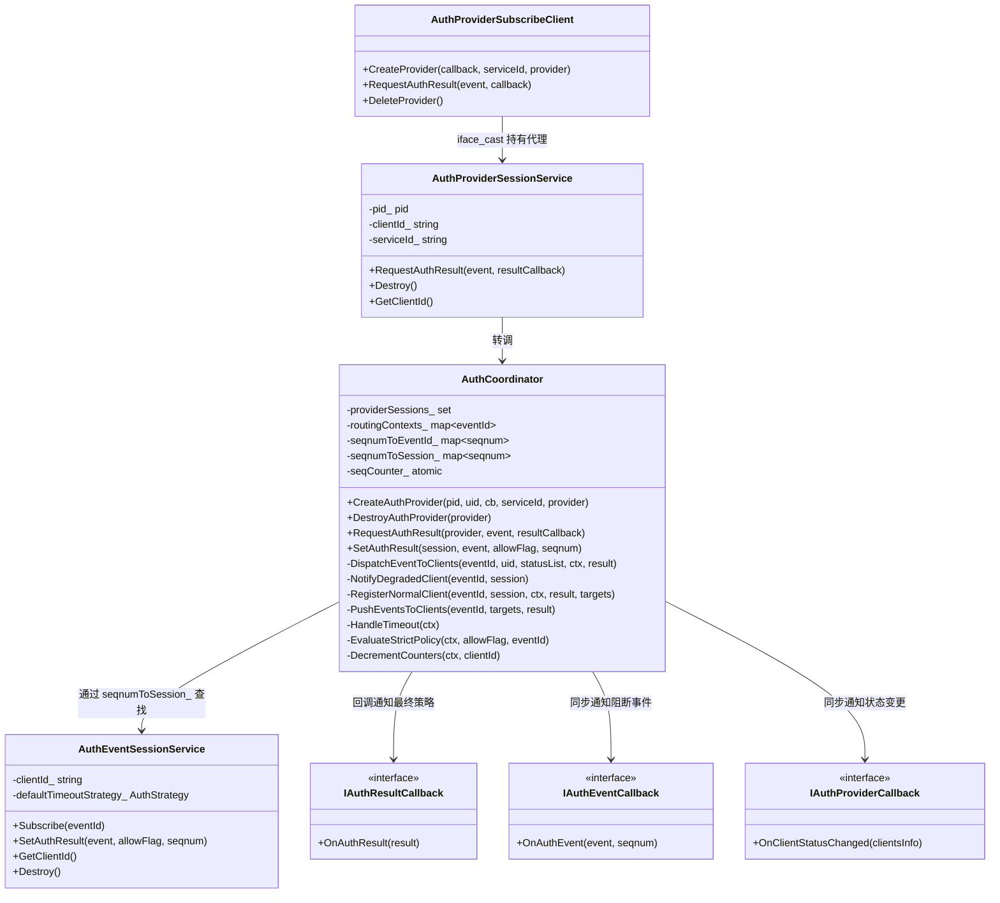
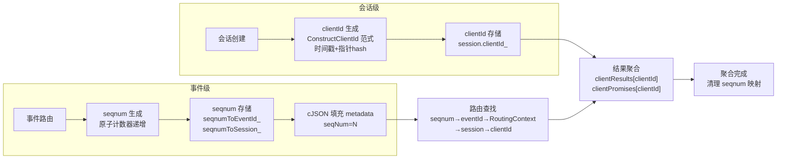
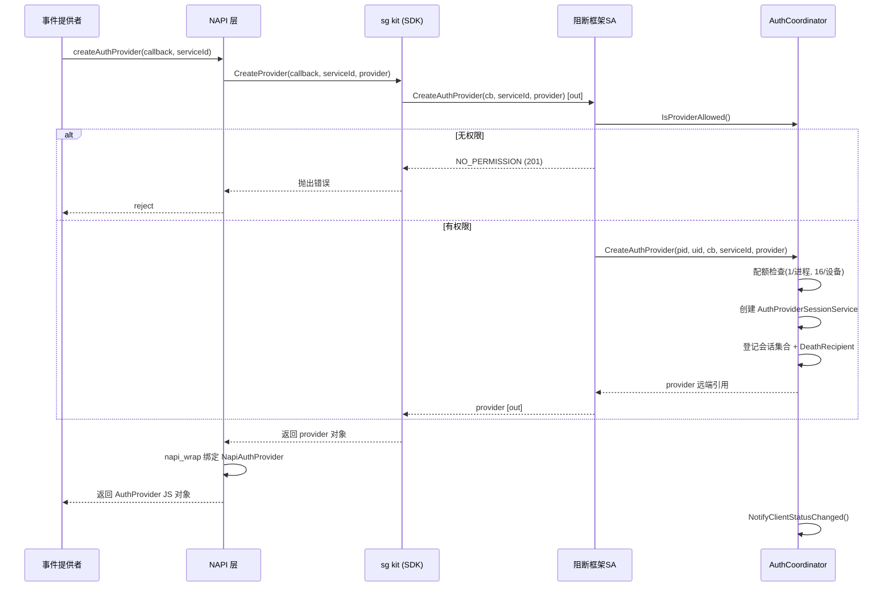
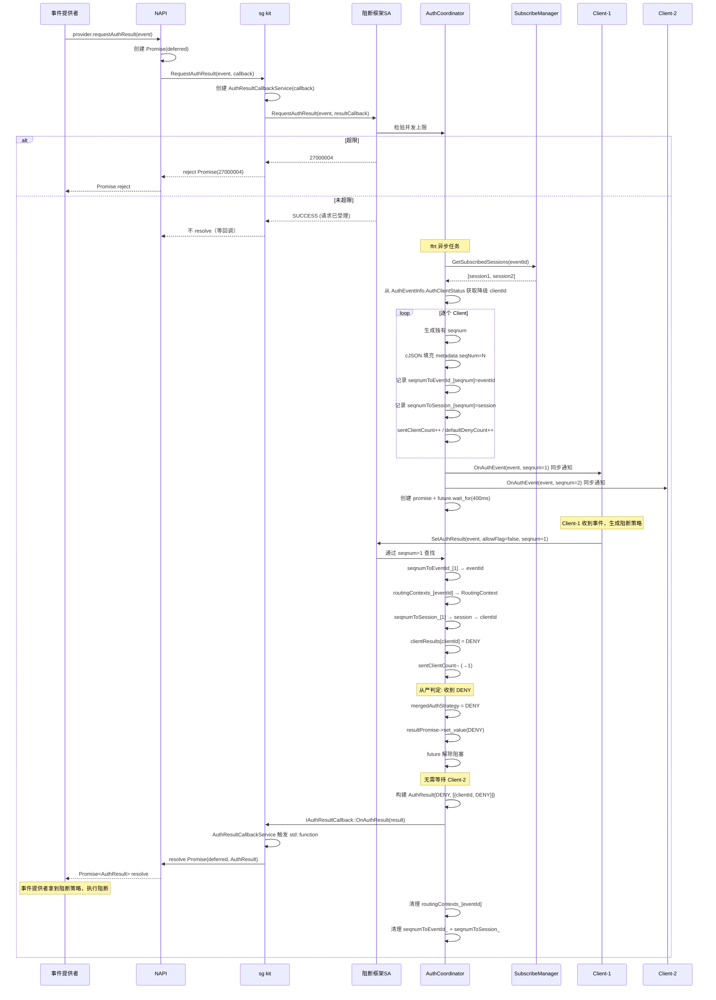
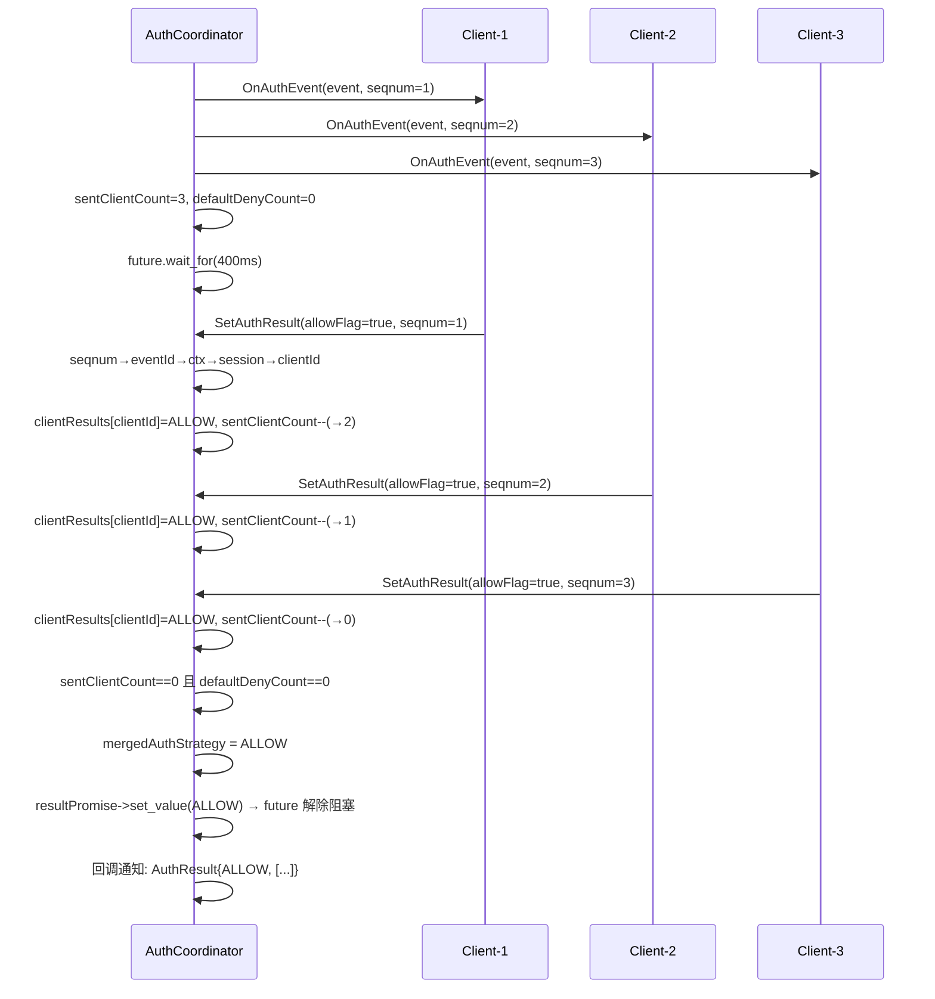
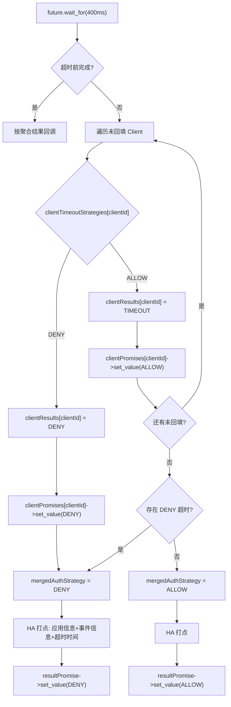
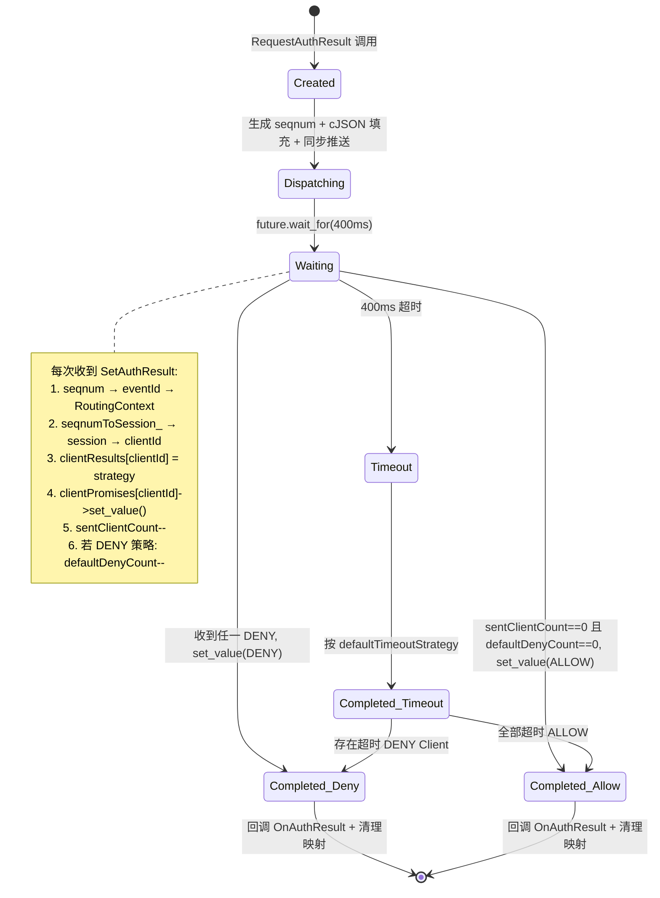
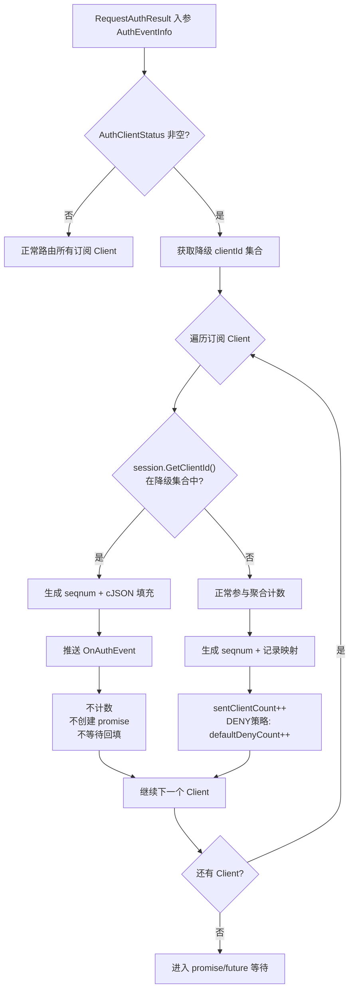
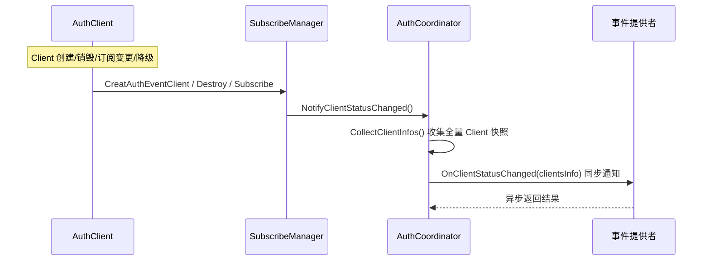
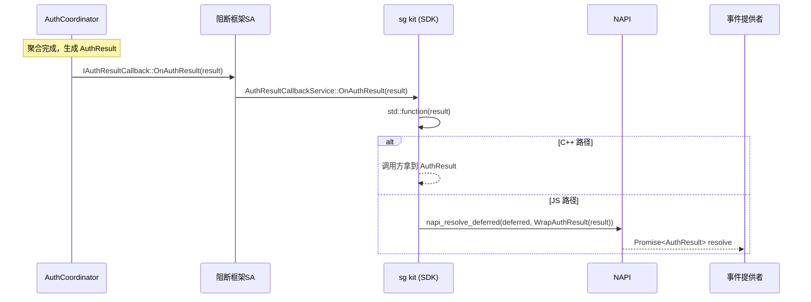

# 阻断框架协调者模块设计文档

> SR-20260806903302 · 支持阻断服务者接入阻断框架
> 状态：已实现并编译通过

## 1. 概述

### 1.1 背景

security_guard 仓库已合入 AuthClient 消费者侧框架（SR20260806903405），提供客户端会话管理、事件订阅与结果回填能力，但缺少事件路由聚合与 Provider 侧接入。本设计新增**协调者模块（AuthCoordinator）**，承接 Provider 会话管理、事件路由、从严聚合与策略回调转发，与消费者侧框架共同构成完整的阻断框架。

### 1.2 目标

- Provider 通过 `CreateAuthProvider` 接入框架，同步验证权限，异步返回会话标识
- Provider 调 `RequestAuthResult` 请求鉴权结果，IPC 异步返回受理码，最终结果经回调通知 Promise
- Client 回填阻断/放行结果，框架按**从严策略**（任一阻断即阻断，全部放行才放行）聚合
- 超时 400ms 未回填的 Client 按其 `defaultTimeoutStrategy` 处置
- SA 聚合完成后经 `IAuthResultCallback` 回调通知 kit → kit 触发 `Promise<AuthResult>`
- 新增 `ohos.permission.AUTH_SERVICE_ACCESS` 权限校验

### 1.3 约束

| 项目 | 约束 |
|---|---|
| 部署位置 | SA 3524（data_collect）同进程 |
| Provider 配额 | 1/进程，16/设备 |
| Client 配额 | 2/进程，16/设备（复用现有） |
| 超时时间 | 硬编码 400ms |
| 等待机制 | std::promise/std::future |
| 路由索引 | seqnum → eventId → RoutingContext → session → clientId |
| 降级来源 | 从 `AuthEventInfo.AuthClientStatus` 入参获取 |
| metadata 序列化 | cJSON |
| 锁约束 | ffrt 任务中用 ffrt 锁，不混用 std mutex |
| 方法入参 | ≤5 |
| 函数行数 | ≤50 |
| 嵌套深度 | ≤5 |
| feature flag | `security_guard_auth_event_enable`（默认 false） |
| 编译条件 | 仅 PC（`security_guard_device_type == "pc"`） |
| 权限 | `ohos.permission.AUTH_SERVICE_ACCESS`（定义在 access_token 部件仓） |

## 2. 模块架构



### 2.1 模块职责

| 模块 | 职责 | 位置 |
|---|---|---|
| AuthProviderSubscribeClient | Provider 侧 SDK，创建会话、请求结果、死亡重连 | `frameworks/common/collect/src/` |
| AuthProviderSessionService | Provider 服务端会话对象，方案 D「会话即远端对象」 | `services/data_collect/sa/` |
| AuthCoordinator | 核心协调者，事件路由 + 从严聚合 + 超时 + 状态通知 | `services/data_collect/sa/` |
| AuthEventSessionService | Client 服务端会话对象，持有 clientId | `services/data_collect/sa/` |
| AuthResultCallbackService | 回调 stub，包装 std::function，SA 聚合完成后触发 | `frameworks/common/collect/src/` |

### 2.2 双标识体系



| 标识 | 生成方式 | 用途 | 生命周期 |
|---|---|---|---|
| clientId | `ConstructClientId` 范式（时间戳 + 指针 hash） | 结果聚合、状态通知、结果返回 | 会话级 |
| seqnum | 原子计数器递增，每客户端每事件独立 | 路由查找（seqnum→eventId→ctx→session→clientId） | 事件级 |

## 3. 核心流程

### 3.1 Provider 创建会话（异步返回）



### 3.2 事件路由与从严聚合（完整链路）



### 3.3 全部放行场景



### 3.4 超时处置流程



### 3.5 路由上下文状态图



### 3.6 降级客户端处理流程



### 3.7 Client 状态通知流程



### 3.8 回调链路（SA → kit → Promise）



## 4. 接口定义

### 4.1 主接口 IDL（DataCollectManagerIdl.idl）

```idl
void CreateAuthProvider([in] IRemoteObject cb, [in] String serviceId, [out] IRemoteObject provider);
void CreatAuthEventClient([in] IRemoteObject cb, [in] int defaultTimeoutStrategy, [in] int defaultTimeoutMs, [out] IRemoteObject session);
```

### 4.2 Provider 会话 IDL（AuthProviderSession.idl）

```idl
// 返回码为请求受理结果，最终策略经 resultCallback 回调返回
void RequestAuthResult([in] AuthEventInfo event, [in] IRemoteObject resultCallback);
void Destroy();
```

### 4.3 Client 会话 IDL（AuthEventSession.idl）

```idl
void Subscribe([in] long eventId);
void Unsubscribe([in] long eventId);
void SetAuthResult([in] AuthEvent event, [in] boolean allowFlag, [in] long seqnum);
void Destroy();
```

### 4.4 回调接口

| 回调 | 方法 | 触发时机 | 方向 |
|---|---|---|---|
| IAuthEventCallback | `OnAuthEvent(event, seqnum)` | SA 向 Client 推送阻断事件 | SA → Client 同步 |
| IAuthProviderCallback | `OnClientStatusChanged(clientsInfo)` | Client 状态变化 | SA → Provider 同步 |
| IAuthResultCallback | `OnAuthResult(result)` | 聚合完成 | SA → kit 回调（触发 Promise） |

### 4.5 NAPI 层

| 函数 | 类型 | 说明 |
|---|---|---|
| `createAuthProvider(callback, serviceId)` | 模块级 | 返回 AuthProvider JS 对象 |
| `destroyAuthProvider(provider)` | 模块级 | 返回 void |
| `provider.requestAuthResult(event)` | 对象方法 | 返回 Promise<AuthResult> |

## 5. 数据结构

### 5.1 AuthEvent（新增 seqnum）

```cpp
class AuthEvent : public Parcelable {
    int64_t eventId_;    // 事件标识
    int64_t seqnum_;     // 事件唯一序号（每客户端每事件独有）
    std::string content_;
    std::string metadata_; // cJSON 序列化 seqNum=N
};
```

### 5.2 核心内部结构

```cpp
struct RoutingContext {
    int64_t eventId;
    size_t sentClientCount;                    // 待回填计数
    size_t defaultDenyCount;                   // 默认阻断计数
    map<string, AuthStrategy> clientResults;   // clientId → 回填策略
    map<string, AuthStrategy> clientTimeoutStrategies; // clientId → 超时策略
    map<string, shared_ptr<promise<AuthStrategy>>> clientPromises; // clientId → promise
    shared_ptr<promise<AuthResult>> resultPromise; // 最终结果 promise
    ffrt::mutex ctxMutex;
    bool completed;
    AuthStrategy mergedAuthStrategy;
};

// 按 eventId 索引（unique_ptr 包装，因 ffrt::mutex 不可移动）
// ffrt lambda 内通过 eventId + mutex_ 查找，不捕获裸指针（生命周期由 map 管理）
map<int64_t, unique_ptr<RoutingContext>> routingContexts_;

// seqnum 路由映射
map<int64_t, int64_t> seqnumToEventId_;        // seqnum → eventId
map<int64_t, AuthEventSessionService*> seqnumToSession_; // seqnum → session
```

### 5.3 clientId 生成

```cpp
// 对齐 ConstructClientId 范式（时间戳 + 指针 hash）
std::string timeStr = std::to_string(std::chrono::steady_clock::now().time_since_epoch().count());
std::string ptrStr = std::to_string(reinterpret_cast<int64_t>(callback.GetRefPtr()));
clientId_ = std::to_string(std::hash<std::string>{}(timeStr + ptrStr));
```

### 5.4 metadata cJSON 序列化

```c
cJSON *root = cJSON_CreateObject();
cJSON_AddNumberToObject(root, "seqNum", (double)seqnum);
char *jsonStr = cJSON_PrintUnformatted(root);
event.SetMetadata(jsonStr);
cJSON_free(jsonStr);
cJSON_Delete(root);
```

## 6. 从严聚合算法

```
输入：eventId, AuthEventInfo.AuthClientStatus[], 已订阅 Client 列表
输出：AuthResult{mergedAuthStrategy, clientAuthResult[]}

1. 从入参 AuthClientStatus 获取降级 clientId 集合

2. 遍历订阅 Client:
   clientId = session.GetClientId()
   IF clientId 在降级集合中:
     生成 seqnum, cJSON 填充 metadata
     推送 OnAuthEvent, 不计数, 跳过
   ELSE:
     生成 seqnum, cJSON 填充 metadata
     记录 seqnumToEventId_[seqnum]=eventId, seqnumToSession_[seqnum]=session
     sentClientCount++
     IF defaultTimeoutStrategy==DENY: defaultDenyCount++

3. 推送 OnAuthEvent 给所有 Client（含降级）

4. 注册 RoutingContext 到 routingContexts_[eventId]
   创建 promise<AuthResult>, future.wait_for(400ms)

5. 每次收到 SetAuthResult(seqnum, allowFlag):
   seqnum → seqnumToEventId_ → eventId → routingContexts_ → RoutingContext
   seqnumToSession_[seqnum] → session → clientId
   clientResults[clientId] = allowFlag ? ALLOW : DENY
   clientPromises[clientId]->set_value(strategy)
   sentClientCount--
   IF clientTimeoutStrategies[clientId]==DENY: defaultDenyCount--

   IF allowFlag == false:
     mergedAuthStrategy = DENY → resultPromise->set_value(DENY)
   ELIF sentClientCount==0 且 defaultDenyCount==0:
     mergedAuthStrategy = ALLOW → resultPromise->set_value(ALLOW)

6. 超时(future 超时):
   FOR 每个未回填 clientId:
     按 defaultTimeoutStrategy:
       DENY → clientResults=DENY, mergedAuthStrategy=DENY
       ALLOW → clientResults=TIMEOUT
   HA 打点

7. 构建 AuthResult, OnAuthResult 回调通知 kit → Promise resolve
8. 清理 routingContexts_[eventId] + seqnumToEventId_ + seqnumToSession_
```

## 7. 编译配置

```gn
# security_guard.gni（复用）
security_guard_auth_event_enable = false  # 默认关闭

# services/data_collect/BUILD.gn
if (security_guard_auth_event_enable) {
    defines += [ "SECURITY_GUARD_AUTH_EVENT_ENABLE" ]
    sources += [ "sa/auth_coordinator.cpp", "sa/auth_provider_session_service.cpp", ... ]
    deps += [ ":auth_provider_session_sa_stub" ]
}
external_deps += [ "cJSON:cjson" ]  # cJSON 依赖

# frameworks/js/napi/BUILD.gn
if (security_guard_auth_event_enable) {
    defines += [ "SECURITY_GUARD_AUTH_EVENT_ENABLE" ]
    sources += [ "napi_block_framework.cpp" ]
}
```

## 8. 权限校验

| 角色 | 权限 | 校验方式 |
|---|---|---|
| Provider | `ohos.permission.AUTH_SERVICE_ACCESS` | HAP: VerifyAccessToken；native: uid 白名单 |
| Client | `ohos.permission.kernel.AUTH_AUDIT_EVENT` | HAP: VerifyAccessToken；native: uid 白名单（不变） |

## 9. 错误码

| 错误码 | 常量名 | 含义 | JS 映射 |
|---|---|---|---|
| 201 | JS_ERR_NO_PERMISSION | 鉴权失败 | 已存在 |
| 202 | JS_ERR_NO_SYSTEMCALL | 非系统应用 | 已存在 |
| 27000001 | AUTH_PROVIDER_INTERNAL_ERROR | 内部错误 | 新增 |
| 27000002 | AUTH_PROVIDER_EXCEED_PROCESS_LIMIT | Provider 进程超限 | 新增 |
| 27000003 | AUTH_PROVIDER_EXCEED_GLOBAL_LIMIT | Provider 全局超限 | 新增 |
| 27000004 | AUTH_REQUEST_EXCEED_LIMIT | 并发请求超限 | 新增 |

## 10. 文件清单

### 新增文件（35 个）

**inner_api 头文件（13 个）**
- `auth_strategy.h`、`auth_event_info.h`、`auth_client_status.h`、`client_auth_result.h`、`auth_result.h`、`auth_client_info.h`
- `i_auth_provider_callback.h`、`i_auth_result_callback.h`
- `auth_provider_callback_stub.h`、`auth_provider_callback_service.h`
- `auth_result_callback_stub.h`、`auth_result_callback_service.h`
- `auth_provider_subscribe_client.h`

**IDL（1 个）**：`AuthProviderSession.idl`

**服务端（3 头 + 3 实现）**：`auth_coordinator.h/.cpp`、`auth_provider_session_service.h/.cpp`、`auth_provider_callback_proxy.h/.cpp`

**Parcelable 实现（6 个）**：`auth_event_info.cpp`、`auth_client_status.cpp`、`client_auth_result.cpp`、`auth_result.cpp`、`auth_client_info.cpp`、`auth_event.cpp`（修改）

**SDK 实现（5 个）**：`auth_provider_callback_service.cpp`、`auth_provider_callback_stub.cpp`、`auth_provider_subscribe_client.cpp`、`auth_result_callback_stub.cpp`、`auth_result_callback_service.cpp`

**NAPI（2 个）**：`napi_block_framework.h/.cpp`

**测试（2 个）**：`auth_coordinator_test.cpp`、`auth_provider_session_service_test.cpp`

### 修改文件（25+ 个）

- IDL、接口码、回调、SDK、服务端、构建配置、错误码、NAPI 注册等（详见 dev-design.md §5）

## 11. 验收标准

| # | 验收项 |
|---|---|
| 1 | 无权限返回 201 |
| 2 | 非系统应用返回 202 |
| 3 | 内部错误返回 27000001 |
| 4 | Provider 进程超限返回 27000002 |
| 5 | Provider 全局超限返回 27000003 |
| 6 | 并发请求超限返回 27000004 |
| 7 | CreateAuthProvider 异步返回会话标识 |
| 8 | RequestAuthResult IPC 异步返回，最终结果经回调通知 Promise |
| 9 | 每个 Client 收到独有 seqnum，metadata 含 cJSON `seqNum=N` |
| 10 | clientId 按 ConstructClientId 范式生成 |
| 11 | SA 通过 seqnum → eventId → RoutingContext → session → clientId 路由 |
| 12 | 双计数正确递减 |
| 13 | 从严策略：任一 DENY 立即阻断 |
| 14 | 从严策略：全部 ALLOW 才放行 |
| 15 | 超时 DENY 触发阻断 |
| 16 | 超时 ALLOW 不阻断 |
| 17 | 降级 Client 只通知不参与聚合 |
| 18 | 无订阅 Client 默认放行 |
| 19 | 聚合完成后清理所有映射 |
| 20 | 回调链路：SA → IAuthResultCallback → kit → Promise resolve |
| 21 | Client 状态变更通知 Provider |
| 22 | Destroy 幂等 |
| 23 | feature flag 关闭时占位返回 FAILED |
| 24 | ffrt 锁不混用 std mutex |
| 25 | 方法入参 ≤5，函数行数 ≤50，嵌套 ≤5 |
