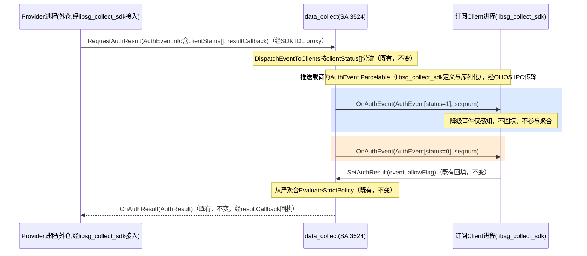

# SR20260818169811 模块边界设计

| 功能名称 | 阻断事件降级状态字段 |
| -------- | -------------------- |
| 设计依据 | SR-design.md v1.0（SR 模式，免拆分 AR=ALL，无 AR-clarify.md） |
| 来源标注 | 统一为 `SR-design提取` |

## Part A: 受影响模块提取 + 架构交叉验证

> 第一轮从功能设计提取，第二轮对照 software_architecture.md 交叉验证补全。

| 模块名称 | 本需求承担功能 | 是否新增 | 来源 |
|---------|---------------|---------|------|
| data_collect（SA 3524） | AuthCoordinator 分流推送时为事件打降级标记：降级路径 NotifyDegradedClient 构造 AuthEvent 后新增 SetStatus(1)；正常路径 PushEventsToClients 构造 AuthEvent 保持 status 默认 0；分流判定逻辑（DispatchEventToClients 按 clientStatus[].IsDegraded() 分流）不变 | 否 | SR-design提取 |
| libsg_collect_sdk（含 AuthEvent Parcelable） | AuthEvent 结构扩展：新增 int32_t status_ {0} 成员（0=正常、1=降级，其余预留）与 GetStatus()/SetStatus(int32_t) 访问器（inner_api 头文件）；Marshalling/ReadFromParcel 尾部追加 WriteInt32/ReadInt32（载荷 v1→v2：4→5 字段）；字段经既有 OnAuthEvent 回调自动透出至订阅 Client | 否 | SR-design提取 |
| test/unittest/data_collect | auth_event_parcelable_test.cpp 序列化断言同步更新，新增 status Marshalling/Unmarshalling 往返用例（置 1 读回 1、默认构造读回 0、字段顺序尾部追加），保障 Parcelable 契约回归（对应 SR TC-003） | 否 | SR-design提取 |

**架构交叉验证**（对照 software_architecture.md 2.1 模块职责表逐行判断是否被本需求必然触达）：

| 架构模块 | 是否触达 | 判断依据 |
|---------|---------|---------|
| risk_classify（SA 3523） | 否 | 仅依赖 data_collect so 与 collect 头目录做风险模型请求（services/risk_classify/BUILD.gn:46），不触碰 AuthEvent 推送/序列化链路 |
| data_collect（SA 3524） | **是** | AuthCoordinator 两个构造点打标（本需求核心写入点） |
| security_collector（SA 3525） | 否 | 采集器管理链路与阻断事件推送无交集 |
| collector_manager | 否 | 采集器 so 加载与本需求链路无关 |
| config_manager | 否 | 无新增配置项、无 EventCfg/serviceId 变更（SR-design 5.4） |
| data_collect/store | 否 | 无持久化变更（SR-design 2.3.2：AuthEvent 为 IPC 消息载体，无表变更） |
| bigdata | 否 | 决策#3 明确不进 HA、不改 AUTH_BLOCK_RESULT 打点与 resultExtra JSON |
| libsg_classify_sdk | 否 | classify 会话与 collect 链路无关 |
| libsg_collect_sdk | **是** | AuthEvent Parcelable 扩展与序列化实现归属本模块 |
| libsg_collector_sdk | 否 | 采集器插件接口与 collect 会话无关 |
| securityguard_napi | 否 | 决策#5 明确 JS/NAPI 不涉及 |
| common 基础库 | 否 | 仅沿用既有 SGLOG 日志宏，无 utils/constants/json 变更 |
| inner_api 头文件（契约行） | 归并 | auth_event.h 契约扩展属于本需求变更，SR-design §8 已显式将其归入 libsg_collect_sdk（含 AuthEvent Parcelable）模块范围，按 SR-design 归属处理，不重复列示 |

注：test/unittest/data_collect 为 data_collect 的单测目录，架构表未单列测试目录，遵循 SR-design §8 模块划分列为第三个受影响模块。

**验证结论**：已对照 software_architecture.md 完成交叉验证，无遗漏。

## Part B: 模块边界定义

> 逐模块定义五个维度的边界：职责、数据主权、上游依赖、下游暴露、模块内变更范围。
> 上游依赖和下游暴露必须拆为子表，逐条列出。

### B.1 data_collect（SA 3524）

| 维度 | 内容 |
|------|------|
| **职责** | 输入：Provider（外仓进程）经 IDL 会话接口发起的 RequestAuthResult（AuthEventInfo 含 clientStatus[] 降级标记 + IRemoteObject resultCallback 回执句柄）。 处理：AuthCoordinator::DispatchEventToClients 按既有分流逻辑分流（auth_coordinator.cpp:317-354，不变）；降级路径 NotifyDegradedClient 构造 AuthEvent（:230-231）后**新增 SetStatus(1)**；正常路径 PushEventsToClients 构造 AuthEvent（:291-294）**保持 status 默认 0**。 产出：经既有 IAuthEventCallback::OnAuthEvent（手写 IPC 回调，TF_ASYNC oneway）向订阅 Client 推送带降级标记的事件。 职责边界：分流判定逻辑不变；聚合/400ms 超时/回填/HA 打点链路零变更（仍由本模块既有代码承担，不在本次改动面内）；AuthEvent 字段与序列化格式由 libsg_collect_sdk 负责；序列化契约回归由 test/unittest/data_collect 负责。Provider 请求流内仅两个构造点打标——预留注入口 NotifyAuthEvent（auth_event_subscribe_manager.cpp:302-330，内部事件源注入，仅单测调用，推送默认构造事件 seqnum=0、status 恒 0）不在打标范围 |
| **数据主权** | 既有持有：订阅会话集合（AuthEventSubscribeManager）、per-client seqnum 分片索引（seqnumShards_）、聚合上下文（promise/超时策略/计数）、订阅配额（16 会话/单进程 2/1024 订阅）——本次均不变更。 本需求不新增数据：status 为单次推送事件的随附属性，不落库、不缓存、无持久化（SR-design 2.3.2） |

**上游依赖明细：**

| 依赖方 | 具体接口/资源 | 协议 | 新增/已有 |
|--------|-------------|------|----------|
| Provider 进程（外仓，经 libsg_collect_sdk 会话接入） | RequestAuthResult(AuthEventInfo event, IRemoteObject resultCallback)（AuthProviderSession.idl:21；resultCallback 即 IAuthResultCallback broker handle，绑定 OnAuthResult 回执通道） | RPC（IDL proxy + samgr） | 已有 |
| libsg_collect_sdk | AuthEvent 构造 / SetSeqnum / **SetStatus(int32_t)**（本次新增 setter 后调用）；AuthEvent Parcelable 序列化符号（auth_event.cpp 同时编入 data_collect so：services/data_collect/BUILD.gn:70；so 链接：BUILD.gn:128） | 进程内 C++ 调用（共享 Parcelable 实现） | 依赖已有；SetStatus 为本次新增的被调接口 |
| OHOS IPC/Parcel | 手写 IAuthEventCallback proxy（OnAuthEvent 推送触发序列化，i_auth_event_callback.h:27-36 + auth_event_callback_proxy.cpp:28-50） | RPC（手写 IPC 回调，TF_ASYNC oneway） | 已有 |

**下游暴露明细：**

| 接口 | 协议 | 入参 | 出参 | 新增/变更 |
|------|------|------|------|----------|
| IAuthEventCallback::OnAuthEvent | RPC（手写 IPC 回调，TF_ASYNC oneway 异步；契约工件 i_auth_event_callback.h + auth_event_callback_proxy.cpp） | AuthEvent（含 status:int32——降级路径 1、正常路径 0，默认 0，其余取值预留）+ seqnum(long) | 无（oneway；proxy 调返回错误码仅表发送结果） | 变更（载荷新增第 5 字段，方法签名不变，载荷 v1→v2） |
| IAuthResultCallback::OnAuthResult | RPC（手写 IPC 回调，auth_result_callback_proxy.cpp:25-42） | AuthResult（聚合后最终策略） | 无 | 已有（不变；聚合回传链路在变更范围外，列示以明确边界） |
| AuthEventSession 会话接口（Subscribe/Unsubscribe/SetAuthResult/Destroy，AuthEventSession.idl:17-21） | RPC（IDL proxy + samgr） | 既有参数 | 既有返回 | 已有（不变）；会话创建 CreatAuthEventClient 在 DataCollectManagerIdl.idl:41，非本会话接口 |

**模块内变更范围：**
- services/data_collect/sa/auth_event/auth_coordinator.cpp — NotifyDegradedClient 构造点（:230-231，SetSeqnum 之后）新增 `event.SetStatus(1)`；PushEventsToClients 构造点（:291-294）保持默认 0，不显式赋值（可补注释说明）
- 分流判定（DispatchEventToClients :317-354）、推送失败处理（:233-242、:296-307 仅记日志不重试）、BUILD.gn 宏包裹（:88-100）均维持现状；无新增文件

### B.2 libsg_collect_sdk（含 AuthEvent Parcelable）

| 维度 | 内容 |
|------|------|
| **职责** | 输入：data_collect 在两个构造点写入的 status 值（降级 1 / 正常 0）。 处理：承载字段——私有成员 `int32_t status_ {0}`（0=正常阻断事件、1=降级阻断事件，其余取值预留）、getter `GetStatus()`/setter `SetStatus(int32_t)`（头文件内联，整型字段命名沿用仓内惯例）；Marshalling/ReadFromParcel 在 metadata 之后尾部追加 WriteInt32/ReadInt32（auth_event.cpp:19-51 既有 4 字段顺序之后）。 产出：扩展后的 AuthEvent 对外契约（inner_api 头文件）与序列化实现（载荷 v2：5 字段），经既有 OnAuthEvent 回调通道自动透出至订阅 Client，SDK 会话接口零变更。 职责边界：不改手写回调契约（IAuthEventCallback 方法签名不变，契约工件 i_auth_event_callback.h）；不改 IDL sequenceable 声明（AuthEventSession.idl:15 仅引用类名）；不改 SDK 会话接口（AuthEventSubscribeClient 等）；不改 JS/NAPI（决策#5）；"何时置 1/0"的打标策略由 data_collect 承担，本模块只表达字段事实 |
| **数据主权** | AuthEvent 结构与序列化格式的唯一主定义权：定长字段顺序 eventId→seqnum→content→metadata→status（尾部追加，int32，0=正常、1=降级），默认 0。 同镜像同版本 SA 与 SDK 序列化一致（决策#7，无跨版本互操作）；未升级的外仓 Client 不读该字段则行为与现状一致。 无持久化数据；SDK 会话/订阅状态数据本次不触碰 |

**上游依赖明细：**

| 依赖方 | 具体接口/资源 | 协议 | 新增/已有 |
|--------|-------------|------|----------|
| OHOS IPC/Parcel | Parcel::WriteInt32/ReadInt32（序列化尾部追加原语） | 平台内建（系统头文件 parcel.h） | 已有（复用既有标量原语，无新增外部依赖，SR-design §3） |
| data_collect（SA 3524） | 会话创建：CreatAuthEventClient（DataCollectManagerIdl.idl:41，经 samgr 获取 SA）；会话四方法：Subscribe/Unsubscribe/SetAuthResult/Destroy（AuthEventSession.idl:17-21，经 IDL proxy） | RPC（IDL proxy + samgr） | 已有（本需求不变） |

**下游暴露明细：**

| 接口 | 协议 | 入参 | 出参 | 新增/变更 |
|------|------|------|------|----------|
| AuthEvent::GetStatus() | inner_api C++ 头文件（进程内符号，头文件内联） | 无 | int32_t（0=正常、1=降级，其余预留） | 新增 |
| AuthEvent::SetStatus(int32_t) | inner_api C++ 头文件（进程内符号，头文件内联） | int32_t status | void | 新增 |
| AuthEvent 序列化载荷（Marshalling/ReadFromParcel） | OHOS IPC Parcel | 5 字段定长顺序（status 追加在 metadata 之后，WriteInt32/ReadInt32） | 序列化结果 | 变更（4→5 字段，载荷 v1→v2） |
| IAuthEventCallback::OnAuthEvent 回调（订阅 Client 经 auth_event_callback_service/stub 基类接入） | RPC（手写 IPC 回调，TF_ASYNC oneway） | AuthEvent（含 status）+ seqnum | 无 | 已有（载荷扩展自动透出，签名不变） |

**模块内变更范围：**
- interfaces/inner_api/collect/include/auth_event/auth_event.h — 公有 getter/setter 区（:32-38 之后）新增 `int32_t GetStatus() const`/`void SetStatus(int32_t)` 内联实现；私有成员区尾部（:47 之后）新增 `int32_t status_ {0}`
- frameworks/common/collect/src/auth_event/auth_event.cpp — Marshalling（:19-34）metadata 写入后追加 `parcel.WriteInt32(status_)`；ReadFromParcel（:36-51）对应追加 `parcel.ReadInt32(status_)`
- 不变更：services/data_collect/idl/AuthEventSession.idl（sequenceable 声明与回调签名不动）；frameworks/common/collect/BUILD.gn（auth_event.cpp 无条件编入于 :63 为既有事实，宏包裹区 :83-99 不含该文件）；version_script（sg_collect_sdk.map）符号导出面不变（新增访问器为头文件内联，无新增导出符号）

### B.3 test/unittest/data_collect

| 维度 | 内容 |
|------|------|
| **职责** | 输入：扩展后的 AuthEvent 契约（5 字段序列化）与 libsg_collect_sdk 序列化实现。 处理：更新 auth_event_parcelable_test.cpp 既有序列化断言；新增状态字段用例——置 status=1 序列化往返读回 1、默认构造读回 0、字段写入顺序位于 metadata 之后（对应 SR-design TC-003）。 产出：Parcelable 契约回归保障（无条件编译，test/unittest/data_collect/BUILD.gn:289）。 职责边界：仅覆盖序列化契约回归，不覆盖分流推送行为（由 SR 系统级用例 TC-001/TC-002/TC-004 与 SA 侧既有测试保障）；不新增 fuzz 目标（既有无 auth fuzz，SR-design §8） |
| **数据主权** | 单测用例与断言数据（内存 Parcel 往返构造）；无生产数据、无持久化 |

**上游依赖明细：**

| 依赖方 | 具体接口/资源 | 协议 | 新增/已有 |
|--------|-------------|------|----------|
| libsg_collect_sdk | AuthEvent 结构与序列化实现（auth_event.h/.cpp） | 进程内（测试直链被测符号） | 已有（随字段扩展同步断言） |
| gtest 单测框架 | TEST 宏与断言 | — | 已有 |

**下游暴露明细：**

| 接口 | 协议 | 入参 | 出参 | 新增/变更 |
|------|------|------|------|----------|
| 无（单测构建目标，仅构建期执行，不对外暴露接口） | — | — | — | — |

**模块内变更范围：**
- test/unittest/data_collect/sa/auth_event_parcelable_test.cpp — 更新既有序列化断言（4→5 字段）+ 新增 status 用例（置 1 往返 / 默认 0 / 尾部追加顺序断言，WriteInt32/ReadInt32）
- test/unittest/data_collect/BUILD.gn — 不变（auth_event_parcelable_test.cpp 已无条件编入 :289）

## Part C: 配置变更清单

> 只列出实际需要变更的配置，不遍历全局配置目录穷举。

**本需求不涉及配置变更。** 依据 SR-design 5.4：沿用既有编译开关 `security_guard_auth_event_enable`（security_guard.gni:21，默认 false；对应 C 宏 `SECURITY_GUARD_AUTH_EVENT_ENABLE`，services/data_collect/BUILD.gn:88-100、frameworks/common/collect/BUILD.gn:83-99），无新增 gni 开关、无新增 C 宏、无新增配置项；oem_property 事件/模型/事件组/信任列表配置零变更。

## Part D: 模块交互时序

> 将功能设计中的业务流程，翻译为模块间的调用时序。以模块为参与方（SR-design 2.1 为业务流程视角，此处不重复）。

**说明：**
- 图例：蓝色区块 = 降级路径推送（本需求变更点：NotifyDegradedClient 构造点新增 SetStatus(1) 打标）；橙色区块 = 正常路径推送（PushEventsToClients 构造点保持 status 默认 0，经 v2 载荷透出）；区块外 = 既有链路零变更（RequestAuthResult、SetAuthResult 回填、从严聚合、OnAuthResult）。
- 参与方接入形态：Provider 会话 SDK（AuthProviderSubscribeClient）与订阅 Client 回调 SDK 同属 libsg_collect_sdk——P→DC 的请求与 DC→P 的回执均经该 SDK 的 IDL proxy 通道。
- 分流推送：同一事件流中降级 client 收 status=1、正常 client 收 status=0，两条推送均经既有 IAuthEventCallback::OnAuthEvent（手写 IPC 回调，TF_ASYNC oneway）完成，签名不变；推送失败仅记 SGLOGE 不重试（既有行为）。
- 回填聚合链路（不变）：仅正常事件触发 SetAuthResult → 从严聚合（任一 DENY 即阻断）→ OnAuthResult 回 Provider；降级事件不进入该链路（不创建 promise/分片索引）。
- 依赖关系与 software_architecture.md 2.2 对照：本次**无新增依赖边**；既有 libsg_collect_sdk → data_collect（IDL proxy + samgr）为 2.2 已记载依赖边。**[与现有不一致]（存量偏差，非本次引入）**：data_collect 对 libsg_collect_sdk 的 so 链接（services/data_collect/BUILD.gn:128）与 auth_event.cpp 双侧源编入（:70，两侧共享同一 Parcelable 实现）为 2.2 依赖图未记载的构建级依赖，与架构 P0 原则"单向依赖分层：接入层 → SA 服务层"字面冲突；本设计的构造点打标 + 双侧共享 Parcelable 源码结构性依赖该存量机制，本次不新增、不扩大该偏差。
- test/unittest/data_collect 为构建期单测，不入运行时时序图。
