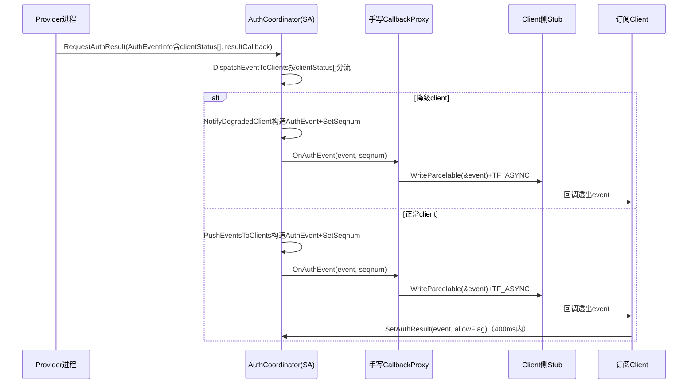

# 详细设计上下文（阻断事件模块组）

> ASIS 阶段文档。只记录现状事实、证据索引与待确认项；正式《模块详细设计说明书.md》由 TOBE 阶段基于本文件生成。

## C1. ASIS 状态与阅读说明

| 项目 | 内容 |
|---|---|
| 本次需求/AR/变更点 | SR20260818169811（AR=ALL）：阻断事件 AuthEvent 新增降级状态字段 `status`（int32_t，0=正常阻断事件、1=降级阻断事件，其余预留）；SA 分流推送两构造点打标（NotifyDegradedClient 置 1 / PushEventsToClients 保持默认 0）；parcelable 单测同步 |
| 变更类型 | 混合变更（既有 AuthEvent 结构扩展 + 既有构造点行为改造 + 测试适配） |
| 目标模块 | data_collect（SA 3524）、libsg_collect_sdk（含 AuthEvent Parcelable）、test/unittest/data_collect |
| 仓库范围 | interfaces/inner_api/collect/include/auth_event/、frameworks/common/collect/src/auth_event/、services/data_collect/sa/auth_event/、test/unittest/data_collect/sa/ |
| 模块边界来源 | `.sdd/software_architecture.md` |
| 边界来源类型 | declared |
| 本次 ASIS 分析范围 | 需求相关切片（AuthEvent 载体、两构造点、序列化链路、parcelable 测试；不含聚合/超时/回填/HA 打点等既有不变链路的深挖） |
| 是否发生范围扩展 | 是，原因：为验证字段透出链路完整性，将探索扩展到手写回调 proxy/stub（auth_event_callback_proxy/stub.cpp）与 SDK 回调分发（auth_event_callback_service.cpp），属边界内证据补强 |
| ASIS 状态 | 完成 |
| 分析置信度 | 高 |
| 后续 TOBE 可引用结论 | A1–A10 |
| 不得定稿的结论 | D1（status 取值枚举常量定义方式）属 TOBE 决策输入 |
| 阻塞或待确认项 | 无阻塞性待确认项 |

## C2. 模块边界确认

| 来源 | 发现 | 边界来源类型 | 影响 |
|---|---|---|---|
| `.sdd/software_architecture.md` | 模块职责表：data_collect（SA 3524，业务）、libsg_collect_sdk（对外 SDK，含 AuthEvent Parcelable）；测试目录未单列，按 SR-design §8 归为 test/unittest/data_collect | declared | 边界清晰，无冲突 |

### C2.1 模块边界

| 分类 | 路径或组件 | 判断依据 | 证据编号 |
|---|---|---|---|
| 确定属于模块 | services/data_collect/sa/auth_event/auth_coordinator.cpp | 软件架构 data_collect 模块职责；SR-design §8 | E1 |
| 确定属于模块 | interfaces/inner_api/collect/include/auth_event/auth_event.h | 软件架构 libsg_collect_sdk 行（含 inner_api 契约归并）；SR-design §8 | E2 |
| 确定属于模块 | frameworks/common/collect/src/auth_event/auth_event.cpp | 软件架构 libsg_collect_sdk 模块 | E3 |
| 确定属于模块 | test/unittest/data_collect/sa/auth_event_parcelable_test.cpp | SR-design §8 测试模块；BUILD.gn:289 无条件编入 | E4 |
| 疑似属于模块 | frameworks/common/collect/src/auth_event/auth_event_callback_service.cpp（回调分发，本次不改但为透出链路证据） | 模块边界内透出链路补强 | E7 |
| 外部依赖 | OHOS IPC/Parcel（WriteInt32/ReadInt32 平台原语） | 平台内建 | E5 |

### C2.2 本次需求相关分析范围

| 分类 | 路径、组件或行为 | 纳入/排除原因 | 证据编号 |
|---|---|---|---|
| 需求相关 | AuthEvent 结构与序列化（auth_event.h/.cpp） | 字段扩展与序列化追加的直接落点 | E2、E3 |
| 需求相关 | NotifyDegradedClient / PushEventsToClients 两构造点 | 打标写入点 | E1 |
| 需求相关 | auth_event_parcelable_test.cpp | 序列化契约回归 | E4 |
| 疑似相关 | OnAuthEvent 手写回调链（proxy/stub/service） | 字段透出通道完整性验证（本次不改） | E7 |
| 本次不分析 | 聚合/超时/回填（HandleTimeout、EvaluateStrictPolicy、SetAuthResult）、HA 打点（AuthEventReporter/IEventWrapper）、JS/NAPI | 问题池决策#3、#5 明确不在变更范围 | E6 |

## C3. 关键 ASIS 事实

| 编号 | 关键现状结论 | 类型 | 对 TOBE/AICoding 的影响 | 来源探索 | 证据编号 |
|---|---|---|---|---|---|
| A1 | AuthEvent 现为 4 字段 Parcelable：`eventId_`、`seqnum_`（int64）、`content_`、`metadata_`（string）；`Marshalling` 按 eventId→seqnum→content→metadata 顺序定长写入，`ReadFromParcel` 逆序读回，`Unmarshalling` 为 new + ReadFromParcel | 事实 | 新字段必须追加尾部为第 5 字段；读写实现需同步三函数 | Q1 | E2、E3 |
| A2 | NotifyDegradedClient（auth_coordinator.cpp:224-244）构造 `AuthEvent(eventId, content)` 后仅 `SetSeqnum(seqnum)`，经 `iface_cast<IAuthEventCallback>` 推送 `OnAuthEvent(event, seqnum)`；推送失败仅记 SGLOGE 返回 | 事实 | status 置 1 的唯一写入点在 SetSeqnum 之后；失败路径无变化 | Q2 | E1 |
| A3 | PushEventsToClients（auth_coordinator.cpp:283-314）循环内构造 `AuthEvent(eventId, content)` 并 `SetSeqnum(seqnum)` 推送；当前无任何降级标记写入 | 事实 | 保持默认 0 无需显式赋值，可加注释说明 | Q2 | E1 |
| A4 | 分流判定：DispatchEventToClients（auth_coordinator.cpp:317-354）从 Provider 入参 `AuthEventInfo.clientStatus[]` 读取 `IsDegraded()`（AuthClientStatus 既有 bool 方法，auth_client_status.h:27-41）构建降级集合，命中走 NotifyDegradedClient，其余走 RegisterNormalClient + PushEventsToClients | 事实 | 分流逻辑不变；status 的值语义与 clientStatus[].IsDegraded 对应（true→1） | Q2 | E1、E8 |
| A5 | 预留第三推送点：AuthEventSubscribeManager::NotifyAuthEvent（auth_event_subscribe_manager.cpp:302-330）推送默认构造事件 `OnAuthEvent(event, 0)`，仅单测调用（auth_event_subscribe_manager_test.cpp:348,365,506），头文件注释"本期预留" | 事实 | status 恒为默认 0；TOBE 需在说明书中声明该预留口不在打标范围 | Q3 | E9 |
| A6 | OnAuthEvent 为手写 IPC 回调（i_auth_event_callback.h:27-36，DECLARE_INTERFACE_DESCRIPTOR + CMD_ON_AUTH_EVENT；proxy auth_event_callback_proxy.cpp:28-50 以 `WriteParcelable(&event)` 装载、TF_ASYNC 发送；stub auth_event_callback_stub.cpp:24-45 `ReadParcelable<AuthEvent>` 读全字段） | 事实 | 新字段经 WriteParcelable/ReadParcelable 全量序列化自动透出，回调签名与命令码零变更 | Q4 | E7 |
| A7 | auth_event.cpp 无条件编入三处：services/data_collect/BUILD.gn:70、frameworks/common/collect/BUILD.gn:63、test/unittest/data_collect/BUILD.gn:271（测试本地编译真实源）；序列化符号被 IDL 生成代码引用，不能挪入宏区 | 事实 | 改动单文件 auth_event.cpp 即可同时生效三侧；不触碰 BUILD.gn | Q5 | E4、E10 |
| A8 | AuthEventSession.idl:15 仅 sequenceable 声明引用类名，方法签名不含字段级契约；`SetAuthResult([in] AuthEvent event, [in] boolean allowFlag)`（:20）为 Client→SA 回填方向 | 事实 | IDL 零改动；回填方向不消费 status | Q6 | E11 |
| A9 | AuthClientStatus 既有整型字段惯例：`AuthStrategy authStrategy_`（枚举 {ALLOW=0,DENY=1,TIMEOUT=2}）配 getter/setter（client_auth_result.h:25-43、auth_strategy.h:21-27）；本仓整型状态字段以枚举 + int32 序列化（WriteInt32）为主流写法 | 事实 | TOBE 可沿用"枚举常量 + int32_t status_"模式；D1 由 TOBE 决定常量定义位置与命名 | Q7 | E12 |
| A10 | auth_event_parcelable_test.cpp 现有 3 例（:32 AuthEventMarshalling001、:45 002、:58 UnmarshallingInvalid），直接 include 真实 auth_event.h，仅用公有构造/Marshalling/Unmarshalling/访问器断言 | 事实 | 新增 status 用例沿用既有断言风格；测试无需桩、无宏包裹 | Q1 | E4 |

### 纯新增对象检索证据

本次新增对象为 AuthEvent 的第 5 字段 `status`（成员 + 访问器 + 序列化），当前不存在：

- 检索方式：`rg "GetStatus|SetStatus|status_"` 于 auth_event.h/.cpp 及 auth_event 全目录——无命中（auth_event.h:32-47 仅有 GetEventId/GetSeqnum/GetContent/GetMetadata 与 Set 系；无 status 成员）。
- 相邻同类实现（可作为惯例参考）：AuthClientStatus.isDegraded_（bool，auth_client_status.h:41）、ClientAuthResult.authStrategy_（枚举 int，client_auth_result.h:42）及其序列化（auth_client_status.cpp:24 WriteBool / client_auth_result.cpp:19-28 WriteInt32）。
- 未发现"status"命名的既有字段；字段名 `status` 不与仓内任何 auth_event 相关符号冲突（检索 `rg "\bstatus\b" interfaces/inner_api/collect auth_event` 无载荷字段级命中）。

## C4. 调用链与数据流

C3 已覆盖两构造点与透出链的字段级行为，此处仅补调用顺序视角。

| 链路/数据对象 | 当前行为 | 与本次需求/变更的关系 | 对 TOBE 的约束 | 证据编号 |
|---|---|---|---|---|
| AuthEvent 生命周期 | SA 构造（栈对象）→ WriteParcelable 跨进程序列化 → Client stub 读回 → 回调透出，单次推送后销毁，无持久化 | 新增 status 随载荷全量透出 | 字段为随附属性，无状态机、无清理需求 | E1、E3、E7 |

现状时序（字段透出全链路，均既有，不变）：

说明：alt 两分支的推送载荷构造方式相同（差异仅分流来源与是否参与聚合）；本需求仅在两分支的构造点分别写入 status=1 / 保持默认 0。

## C5. 配置、数据、测试与依赖现状

| 主题 | 现状 | 风险或限制 | 与本次需求/变更的关系 | 证据编号 |
|---|---|---|---|---|
| 配置 | 无 auth_event 相关运行时配置项；仅编译开关 security_guard_auth_event_enable（gni:21 默认 false）+ 宏 SECURITY_GUARD_AUTH_EVENT_ENABLE（BUILD.gn:88-100） | 无 | 本次不新增配置（SR-design 5.4） | E10 |
| 参数校验 | AuthEvent 各字段当前无运行时校验（长度校验仅在订阅侧对回填 content，auth_event_subscribe_manager.cpp:208-211） | status 为 SA 内部写入，Client 只读，无注入面 | TOBE 无需为 status 增加校验 | E13 |
| 依赖 | data_collect 链接 libsg_collect_sdk so（BUILD.gn:128）并源编 auth_event.cpp（:70）；SDK 侧同文件独立编入（frameworks/common/collect/BUILD.gn:63） | 同文件双侧编译，序列化改动必须一次性同步（同一提交） | 改动天然两侧一致，无独立发布风险 | E10 |
| 符号导出 | 新增 getter/setter 为头文件内联，不新增导出符号；sg_collect_sdk.map:71-75 已导出 AuthEvent vtable 与既有方法 | 无 | version_script 无需变更 | E14 |
| 并发 | 两构造点均为栈对象构造 + 单线程推送上下文（ffrt 任务内），字段写入无共享状态 | 无 | 无锁、无并发约束 | E1 |

### C5.1 测试覆盖现状

| 测试文件或套件 | 覆盖行为 | 与本次需求的关系 | 未覆盖风险 | 证据编号 |
|---|---|---|---|---|
| auth_event_parcelable_test.cpp（3 例，无条件编译） | 4 字段 Marshalling 往返 + Unmarshalling 非法输入 | status 扩展后必须更新（新增 status 往返/默认 0/尾部顺序断言） | 不更新则断言不感知新字段（不会编译失败，但契约回归缺失） | E4 |
| auth_coordinator_test.cpp（8 例，宏区） | 分流/聚合/回填边界（含 SetAuthResultNoRoutingContext001） | 不直接断言载荷字段；TC-001/002/004 行为断言可在 SA 侧用例补 | 既有用例不校验 status 值 | E15 |
| auth_event_sdk_test.cpp（SDK 侧 8 例） | 客户端会话行为，不断言字段数与载荷大小 | 5 字段扩展后仍通过，无需适配 | 无 | E16 |
| fuzztest | 无 auth 专属 fuzz 目标 | 不涉及 | 无 | E17 |

## C6. 规格漂移、待确认与阻塞

| 编号 | 类型 | 现状/漂移/风险 | 影响 | 后续关注点 | 证据编号 |
|---|---|---|---|---|---|
| S1 | 隐藏约束 | auth_event.cpp 被三处 BUILD.gn 无条件编入且符号被 IDL 生成代码引用——字段扩展必须单文件内完成且不能挪文件位置 | 实现位置受锁；不允许把序列化实现挪进宏隔离区 | task-dev 需在既有文件内改 | E4、E10 |
| S2 | 兼容 | 预留注入口 NotifyAuthEvent（seqnum=0）推送的事件 status 将恒为 0，与"正常事件需回填"语义存在歧义（该口无 routing context，回填得 NOT_FOUND） | 预留口未投产（仅单测调用），语义歧义暂无运行时影响 | TOBE 说明书中显式声明该口不在打标范围 | E9 |

### C6.1 待确认问题

| 问题 | 类型 | 为什么影响 TOBE/AICoding | 当前线索 | 建议确认对象 |
|---|---|---|---|---|
| D1：status 取值常量的定义形态（枚举 vs #define vs constexpr，定义于 auth_event.h 还是独立头） | TOBE 决策输入 | 影响契约面：外仓 Client 依赖符号名与取值口径；A9 表明仓内惯例为枚举（AuthStrategy 先例） | auth_strategy.h:21-27 枚举模式；auth_client_status.h 布尔直用 | TOBE 阶段基于 A9 惯例提出方案 |

### C6.2 ASIS 阻塞项

不适用，原因：ASIS 状态为完成，无阻塞性缺口。

## C7. 证据索引

| 编号 | 证据类型 | 位置 | 检索方式 | 支撑结论 |
|---|---|---|---|---|
| E1 | 文件+行号 | services/data_collect/sa/auth_event/auth_coordinator.cpp:224-244,283-354 | 直接阅读 | A2、A3、A4 |
| E2 | 文件+行号 | interfaces/inner_api/collect/include/auth_event/auth_event.h:25-48 | 直接阅读 | A1 |
| E3 | 文件+行号 | frameworks/common/collect/src/auth_event/auth_event.cpp:19-62 | 直接阅读 | A1 |
| E4 | 文件+行号 | test/unittest/data_collect/sa/auth_event_parcelable_test.cpp:16-18,32-58；test/unittest/data_collect/BUILD.gn:271,289 | 直接阅读 | A7、A10 |
| E5 | 平台头文件 | OHOS parcel.h（WriteInt32/ReadInt32 标量原语） | 接口知识 | C2.1 外部依赖 |
| E6 | 问题池归档 | ~/.question-tracker/.../sr20260818169811-阻断事件降级-20261116（决策#3/#5） | 问题池状态 | C2.2 排除范围 |
| E7 | 文件+行号 | interfaces/inner_api/collect/include/auth_event/i_auth_event_callback.h:27-36；services/data_collect/sa/auth_event/auth_event_callback_proxy.cpp:28-50；frameworks/common/collect/src/auth_event/auth_event_callback_stub.cpp:24-45、auth_event_callback_service.cpp:72-74 | 直接阅读 | A6 |
| E8 | 文件+行号 | interfaces/inner_api/collect/include/auth_event/auth_client_status.h:27-41 | 直接阅读 | A4 |
| E9 | 文件+行号 | services/data_collect/sa/auth_event/auth_event_subscribe_manager.cpp:302-330；sa/include/auth_event/auth_event_subscribe_manager.h:67-68；test/.../auth_event_subscribe_manager_test.cpp:348,365,506 | rg "OnAuthEvent" 全仓 | A5、S2 |
| E10 | 文件+行号 | services/data_collect/BUILD.gn:70,88-100,128；frameworks/common/collect/BUILD.gn:63,83-99；security_guard.gni:21 | 直接阅读 | A7、S1、C5 |
| E11 | IDL | services/data_collect/idl/AuthEventSession.idl:15,20 | 直接阅读 | A8 |
| E12 | 文件+行号 | interfaces/inner_api/collect/include/auth_event/auth_strategy.h:21-27；client_auth_result.h:25-43；frameworks/common/collect/src/auth_event/client_auth_result.cpp:19-28 | 直接阅读 | A9 |
| E13 | 文件+行号 | services/data_collect/sa/auth_event/auth_event_subscribe_manager.cpp:208-211 | 直接阅读 | C5 参数校验 |
| E14 | 文件+行号 | frameworks/common/collect/sg_collect_sdk.map:71-75 | 直接阅读 | C5 符号导出 |
| E15 | 文件+行号 | test/unittest/data_collect/sa/auth_coordinator_test.cpp（8 例） | 直接阅读 | C5.1 |
| E16 | 文件+行号 | frameworks/common/collect/test/unittest/src/auth_event_sdk_test.cpp:83-126 | 直接阅读 | C5.1 |
| E17 | 目录检索 | test/fuzztest/（无 auth 专属目标） | rg --files | C5.1 |
| E18 | 检索证据 | rg "GetStatus\|SetStatus\|status_" auth_event 相关目录——无命中（新增对象不存在） | rg | C3 纯新增检索 |

## C8. 需求/AR 追溯矩阵

| 编号 | 需求/AR/功能点/影响点 | 本模块相关性 | ASIS 结论编号 | 证据编号 | 覆盖状态 |
|---|---|---|---|---|---|
| R1 | AuthEvent 新增 status 字段（int32，0=正常/1=降级，默认 0） | 需求相关 | A1、A7、A9、E18 | 已覆盖 |
| R2 | NotifyDegradedClient 构造点置 status=1 | 需求相关 | A2、A4 | E1 | 已覆盖 |
| R3 | PushEventsToClients 构造点保持 status=0 | 需求相关 | A3、A4 | E1 | 已覆盖 |
| R4 | status 经既有 OnAuthEvent 通道自动透出（签名/回调零变更） | 需求相关 | A6、A8 | E7、E11 | 已覆盖 |
| R5 | parcelable 单测同步（往返/默认值/尾部顺序） | 需求相关 | A10 | E4 | 已覆盖 |
| R6 | 预留口 NotifyAuthEvent 不在打标范围 | 疑似相关 | A5、S2 | E9 | 已覆盖 |
| R7 | IDL/配置/HA/JS 均不涉及 | 不涉及本模块（问题池决策#3、#5、#7） | A7、A8 | E6、E10、E11 | 不涉及本模块 |

## C14. TOBE 推导依据

| 决策编号 | 输入依据 | 推导过程摘要 | 被采纳原因 |
|---|---|---|---|
| D1-常量形态 | R1 / A9 / E12 | ASIS A9 表明仓内整型状态字段主流写法为"枚举常量 + int32 序列化"（AuthStrategy 枚举先例：auth_strategy.h:21-27 于头文件内定义 enum class，值 {ALLOW=0,DENY=1,TIMEOUT=2}，配 AUTH_RESULT_TIMEOUT_MS 等常量）。status 取值 0/1 需语义符号供 SA 写入与外仓 Client 判读 | 在 auth_event.h 内定义 `enum class AuthEventStatus : int32_t { NORMAL = 0, DEGRADED = 1 }`，成员访问器仍为 GetStatus/SetStatus(int32_t)，序列化直接 WriteInt32(status_)——与 AuthStrategy 完全同构，外仓可 include 常量，枚举名不进契约面（载荷仍为裸 int32） |
| D2-字段形态 | R1 / A1 / E2 / E18 | ASIS A1：4 字段定长顺序序列化；E18：status 当前不存在；用户变更决策（int32_t status_，0/1，GetStatus/SetStatus） | 尾部追加第 5 字段，读写原语 WriteInt32/ReadInt32，与既有 ClientAuthResult.authStrategy_ 的 int 序列化写法一致（E12） |
| D3-写入点 | R2/R3 / A2 / A3 / E1 | 两构造点构造后均只 SetSeqnum；降级路径需显式置 1，正常路径保持默认 0 | NotifyDegradedClient 在 SetSeqnum 后加 SetStatus(1)（对齐 A2 行序）；PushEventsToClients 不显式赋值，仅注释说明默认 0（A3） |
| D4-预留口 | R6 / A5 / S2 / E9 | NotifyAuthEvent 为预留口（仅单测调用），推送默认构造事件 | 不在打标范围；说明书显式声明该口事件 status 恒为默认 0，语义歧义（seqnum=0 无 routing context）留作已知限制 |

## C15. 替代方案与反证记录

| 编号 | 方案/反例 | 结论 | 未采纳或需整改原因 |
|---|---|---|---|
| ALT1 | status 常量用 #define / constexpr 裸常量 | 不采纳 | 与仓内 AuthStrategy 枚举惯例不符（A9），且枚举提供类型安全与可读性 |
| ALT2 | 在序列化中写入字符串状态名（"NORMAL"/"DEGRADED"） | 不采纳 | 载荷膨胀（4→8+ 字节），与定长 int 序列化惯例冲突（A1/E12）；用户已决策 int 形态 |
| ALT3 | 正常路径也显式 SetStatus(0) | 不采纳 | 成员默认初始化 status_{0} 已保证语义；显式赋值属冗余样板（仅加注释） |

## C16. 完整追踪矩阵

| 需求/AR | ASIS 结论 | 证据 | 契约 | TOBE 决策 | 正式说明书章节 | 可测试性输入 |
|---|---|---|---|---|---|---|
| R1 字段扩展 | A1、A7、A9 | E2、E3、E12、E18 | K1、K2 | D2、D1-常量形态 | 4.1.3 | 序列化往返（1/默认 0/尾部顺序） |
| R2 降级置 1 | A2 | E1 | K2 | D3 | 4.1.2/4.1.3 | 分流后 Client 读到 1 |
| R3 正常保持 0 | A3 | E1 | K2 | D3 | 4.1.2 | 正常推送读 0 |
| R4 通道透出 | A6、A8 | E7、E11 | K3 | （零改动，引用） | 4.1.2 | 经回调全量透出 |
| R5 测试适配 | A10 | E4 | K4 | （测试设计承接） | 4.1.4 | parcelable 用例更新 |
| R6 预留口 | A5、S2 | E9 | — | D4 | 4.1.4/9 | 预留口恒 0 声明 |
