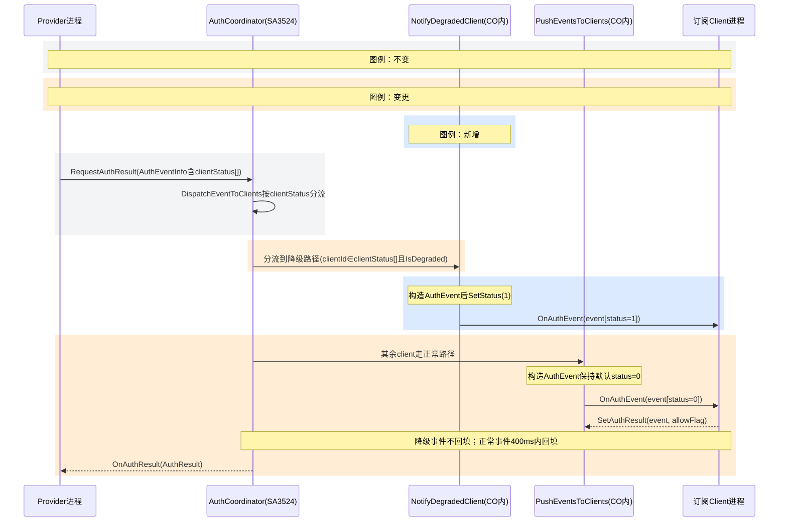
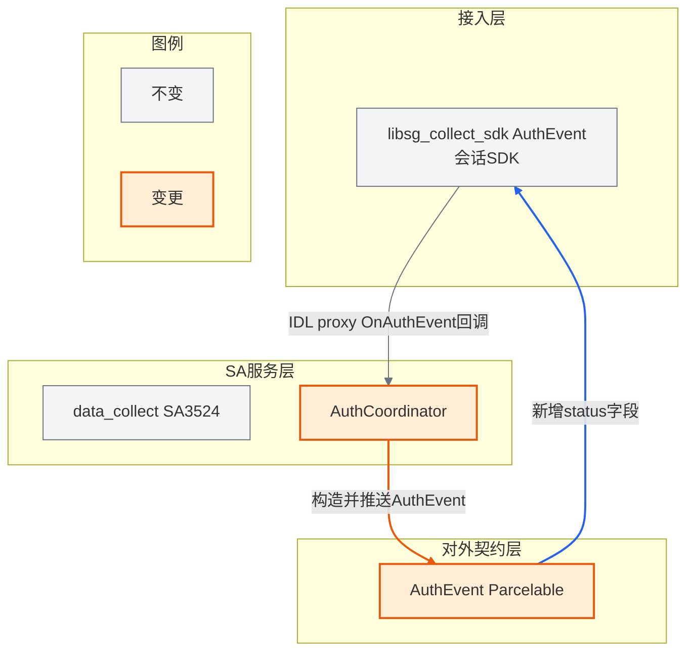

# 功能设计文档

## 文档信息

| 字段     | 内容                       | 取值规则 |
| -------- | -------------------------- | -------- |
| 功能名称 | 阻断事件降级状态字段       | 取本次 SR 的功能名称 |
| 版本     | 1.1                        | 首次生成填 `1.0`；每轮 gate 整改后次版本号 +1（`1.1`、`1.2`…） |
| 作者     | `sr-design skill`          | 固定值，不填人名 |
| 日期     | 2026-11-16                 | 本轮生成日期 |
| 状态     | 整改稿（第 1 轮）           | 首次生成填「草稿」 |

## 修订记录

| 版本 | 日期       | 作者             | 触发原因   | 变更说明 |
| ---- | ---------- | ---------------- | ---------- | -------- |
| 1.0  | 2026-11-16 | `sr-design skill` | 首次生成   | AuthEvent 新增 status 字段，区分正常/降级阻断事件 |
| 1.1  | 2026-11-16 | `sr-design skill` | 用户变更   | 字段形态变更：bool isDegraded → int32_t status（0=正常/1=降级，其余预留），访问器 GetStatus()/SetStatus(int32_t)，序列化 WriteInt32/ReadInt32 |

---

## 1. 需求背景

### 1.1 业务背景

**业务问题**：AuthEvent 阻断框架（SA 3524 data_collect，特性开关 `security_guard_auth_event_enable`）在事件分发时存在两条推送路径：正常路径（`PushEventsToClients`）要求 Client 在 400ms 内回填决策；降级路径（`NotifyDegradedClient`）仅通知不参与聚合。当前两条路径构造的 `AuthEvent` 结构完全相同，Client 收到事件后无法区分本次是"正常阻断事件"（需要参与决策回填）还是"降级阻断事件"（仅感知、无需回填），导致 Client 侧行为无法分化。

**需求目标**：在阻断事件 `AuthEvent` 中新增降级状态字段 `status`（int32）：降级路径推送的事件 `status = 1`，正常路径推送的事件 `status = 0`，Client 据此区分事件类型。

**受益方**：阻断事件订阅 Client（外仓 native 进程，经 libsg_collect_sdk 的 `IAuthEventCallback::OnAuthEvent` 接收事件）。

**前置条件**：设备构建开启 `security_guard_auth_event_enable`（默认 false，仅特定设备开启）。

**原始需求**：`支持阻断事件中新增降级状态字段，可区分出当前是正常阻断事件还是降级阻断事件`（original-requirement.md:1）。

### 1.2 现状约束

- **数据结构约束**：`AuthEvent` 为 IDL sequenceable（AuthEventSession.idl:15），序列化自包含在 Parcelable 实现内（auth_event.cpp:19-62，定长 4 字段顺序：eventId、seqnum、content、metadata）。新增字段必须追加在序列化尾部，保证同镜像同版本 SA 与 SDK 的序列化一致。
- **特性开关约束**：auth_event 相关服务端与 SDK 代码均被 `SECURITY_GUARD_AUTH_EVENT_ENABLE` 宏包裹（services/data_collect/BUILD.gn:88-100、frameworks/common/collect/BUILD.gn:83-99）；`auth_event.cpp` 无条件编译（序列化符号被 IDL 生成代码引用）。本次改动沿用既有宏包裹策略，不改变默认产物行为。
- **分发逻辑约束**：`DispatchEventToClients`（auth_coordinator.cpp:317-354）按 Provider 入参 `AuthEventInfo.clientStatus[]` 的 `IsDegraded()` 将 client 分流到降级/正常两条路径；本次不改变分流逻辑本身，只在两条路径的构造点上分别打标。
- **测试约束**：`auth_event_parcelable_test.cpp` 无条件编译（test/unittest/data_collect/BUILD.gn:289），序列化变更必须同步更新该测试。
- **聚合与打点不涉及**：降级 client 不参与聚合、不产生 AUTH_BLOCK_RESULT 打点（问题池决策：不进 HA、不改 resultExtra JSON、不跨仓改 IEventWrapper 签名）。

---

## 2. 功能设计

### 2.1 主流程

> - 步骤1（不变）：Provider 经 `RequestAuthResult` 发起鉴权请求，`AuthEventInfo.clientStatus[]` 携带各 client 降级标记；`DispatchEventToClients`（auth_coordinator.cpp:322-326）读取该标记构建降级 client 集合。
> - 步骤2（变更）：分流到降级路径的调用 `NotifyDegradedClient`（auth_coordinator.cpp:341-344）。
> - 步骤3（新增）：`NotifyDegradedClient` 构造 `AuthEvent(eventId, content)` 并 `SetSeqnum(seqnum)` 后（auth_coordinator.cpp:230-231），**新增** `SetStatus(1)`，再经 `IAuthEventCallback::OnAuthEvent` 推送（异步 oneway，推送失败仅记日志，auth_coordinator.cpp:238-242 既有行为不变）。
> - 步骤4（变更）：`PushEventsToClients`（auth_coordinator.cpp:291-294）构造 `AuthEvent` 时保持 `status_` 默认 0，无需显式赋值。
> - 步骤5（不变）：正常 client 回填 `SetAuthResult`、聚合、`OnAuthResult` 返回 Provider——本需求不触碰；降级 client 不回填不参与聚合。
> - 幂等性：字段为事件推送的随附属性，单次推送单次赋值，无幂等问题。

设计意图：降级状态是"事件分流路径"的属性（问题池决策#6），在两条路径的构造点分别打标是最小且无歧义的实现——不改变分流判定、不触碰聚合与回填链路。推送为异步 oneway，主流程不变。

### 2.2 功能定位

文字说明：改动全部落在 data_collect（SA 3524）模块内的 `AuthCoordinator`（打标写入点），与对外契约层的 `AuthEvent` Parcelable（新增字段与序列化）。SDK 侧无接口变更，字段经既有 `OnAuthEvent` 回调自动透出。Provider 侧、JS/NAPI 侧、聚合与打点链路均不变。

设计意图：复用既有 AuthEvent 推送通道，不新增模块、不新增 IPC 接口；变更集中在事件本体与其两个构造点，符合"框架不做业务决策、字段只表达事实"的分层约束。

### 2.3 数据设计

#### 2.3.1 数据模型

不涉及数据库表变更。本次唯一数据结构变更：

| 结构名 | 用途 | 关键字段 | 变更类型 |
| :------ | :--- | :------- | :------- |
| AuthEvent（interfaces/inner_api/collect/include/auth_event/auth_event.h:25） | 阻断事件 Parcelable，SA→Client 推送载体 | 新增 `int32_t status_ {0}`（0=正常阻断事件、1=降级阻断事件，其余取值预留）；新增 getter `GetStatus()` 与 setter `SetStatus(int32_t)`；`Marshalling`/`ReadFromParcel` 尾部追加 `WriteInt32`/`ReadInt32`（auth_event.cpp） | 修改 |

设计意图：int 形态为后续状态分类扩展预留（0/1 之外可继续定义），访问器命名沿用仓内整型字段惯例（GetStatus/SetStatus）；序列化尾部追加保证字段顺序稳定（问题池决策#4，2026-11-16 用户变更）。

#### 2.3.2 存储策略

不涉及持久化：AuthEvent 为 IPC 消息载体，生命周期为单次推送；无表、无缓存、无清理策略。不适用：无持久化数据（问题池决策#1、#6）。

---

## 3. 外部依赖

| 依赖名称 | 提供方 | 用途 | 接口/资源标识 | 变更类型 | 权威规范及版本 |
| :------- | :----- | :--- | :------------ | :------- | :------------- |
| OHOS IPC/Parcel | OHOS 内核 | AuthEvent 跨进程序列化 | Parcel::WriteInt32/ReadInt32 | 复用 | OHOS IPC 标准接口，系统头文件 parcel.h；无独立版本号（平台内建） |

不适用展开：本次仅复用 Parcel 既有标量读写原语，无新增/修改外部依赖接口。IEventWrapper（sg_ext）经问题池决策#3 明确不涉及。

---

## 4. 对外接口

| 接口名称 | 用途 | 交互类型 | 接口标识 | 变更类型 | 契约版本 |
| :------- | :--- | :------- | :------- | :------- | :------- |
| IAuthEventCallback::OnAuthEvent | SA→订阅 Client 推送阻断事件（载荷扩展） | RPC（IDL 回调，oneway 异步） | IAuthEventCallback#OnAuthEvent(AuthEvent, long seqnum) | 修改（载荷字段新增，签名不变） | AuthEvent 载荷版本 2（4 字段 → 5 字段） |

### 4.1 IAuthEventCallback::OnAuthEvent 载荷变更

#### 4.1.1 基本契约

| 属性 | 内容 |
| :--- | :--- |
| 调用方 → 提供方 | AuthCoordinator（SA 3524） → 订阅 Client（外仓 native 进程，经 libsg_collect_sdk 注册回调） |
| 交互类型 | RPC（IDL 生成回调，异步推送） |
| 接口标识 | IAuthEventCallback#OnAuthEvent([in] AuthEvent event, [in] long seqnum) |
| 协议专属属性 | RPC 调用模式：oneway 异步；无返回值语义（proxy 调返回错误码仅表发送结果） |
| 契约版本 | 载荷 v2（新增第 5 字段） |
| 变更类型 | 修改（仅 Parcelable 载荷扩展，方法签名与 IDL 不变） |

#### 4.1.2 请求/输入契约（AuthEvent 载荷，SA→Client 方向）

| 字段路径 | 位置 | 类型 | 必填 | 可空 | 默认值 | 枚举/格式/长度/范围约束 | 业务语义 | 敏感级别 | 示例 |
| :------- | :--- | :--- | :--- | :--- | :----- | :--------------------- | :------- | :--------- | :--- |
| eventId | message(AuthEvent) | int64 | 是 | 否 | 0 | 无 | 阻断事件 ID | 内部 | 1010100 |
| seqnum | message(AuthEvent) | int64 | 是 | 否 | 0 | 无 | per-client 路由键，SA 生成 | 内部 | 168 |
| content | message(AuthEvent) | string | 是 | 是 | "" | ≤4096（订阅侧校验上限，auth_event_subscribe_manager.cpp:208-211 对回填侧） | 事件内容 JSON | 敏感 | `{"pkg":"com.x"}` |
| metadata | message(AuthEvent) | string | 是 | 是 | "" | 无 | SA 留空，由消费方填充 | 内部 | "" |
| **status** | message(AuthEvent) | **int32** | **是** | **否** | **0** | **枚举：0=正常、1=降级，其余取值预留（未定义值按正常处理）** | **0=正常阻断事件（需 400ms 内回填）；1=降级阻断事件（仅通知，不参与聚合回填）** | **公开** | **1** |

#### 4.1.3 响应/输出契约

不适用：oneway 异步回调无响应；Client 侧对正常事件的回填走 `SetAuthResult`（既有接口，签名不变）。

#### 4.1.4 错误契约

不适用：字段为推送载荷属性，不引入新错误分支。既有推送失败处理不变（proxy 为空或发送失败仅记日志，auth_coordinator.cpp:233-242、296-307）。

#### 4.1.5 接口非功能约束

| 认证与鉴权 | 幂等与去重 | 超时 | 重试 | 限流与配额 | SLA（服务等级协议）与性能承诺 | 熔断与降级 | 版本与兼容性 |
| :--------- | :--------- | :--- | :--- | :--------- | :---------------------------- | :--------- | :----------- |
| 既有订阅鉴权不变（native token uid 白名单 / HAP 权限 ohos.permission.kernel.AUTH_AUDIT_EVENT，auth_event_subscribe_manager.h:75-80） | 不适用：单次推送单次赋值 | 不适用：oneway 无等待 | 不适用：既有行为不重试 | 既有会话配额不变（全局 16/单进程 2/订阅 1024） | 不变：单字段新增对推送时延影响 <1μs 级，无新增 SLA | 不适用：无新失败模式 | 同镜像同版本编译部署，无跨版本互操作（问题池决策#7）；外仓 Client 需同步升级头文件后才能读到新字段 |

#### 4.1.6 变更差异

| 变更对象 | 变更前 | 变更后 | 兼容性影响 | 调用方适配 |
| :------- | :----- | :----- | :--------- | :--------- |
| AuthEvent Parcelable 载荷 | 定长 4 字段（eventId:int64、seqnum:int64、content:string、metadata:string，auth_event.cpp:19-34） | 尾部追加第 5 字段 status:int32（默认 0：0=正常、1=降级，其余预留） | 兼容（同镜像 SA 与 SDK 同版本编译，序列化两侧一致；接口签名与 IDL 不变） | 外仓 Client 侧重新编译后经 `event.GetStatus()` 读取；未升级方不读该字段则行为与现状一致 |

#### 4.1.7 完整示例

不适用：字段表示例已完整表达契约（新增字段为单一布尔标量，无嵌套/数组/联合类型）。

设计意图：不新增接口、不改签名，仅扩展推送载荷——Client 按字段值分化行为（降级事件仅感知），Provider/聚合链路零感知，改动面最小。

---

## 5. DFX 设计

### 5.1 异常场景、冲突场景、兼容场景

| 场景分类 | 场景名称 | 触发条件 | 系统表现（功能视角+模块视角） | 处理/恢复方式 |
| :------- | :------- | :------- | :---------------------------- | :------------ |
| 异常 | 降级推送失败 | 降级 client 回调 proxy 为 null 或 OnAuthEvent 发送失败 | Client 未收到事件；SA 仅记 SGLOGE 日志（auth_coordinator.cpp:233-242 既有行为） | 无自动恢复；日志排查，与现状一致 |
| 异常 | client 未在 clientStatus[] 中标记但会话失效 | DispatchEventToClients 遇 null/invalid 会话 | 跳过该会话（auth_coordinator.cpp:333-338），事件不推送 | 会话死亡既有清理机制（SubscriberDied）处理 |
| 冲突 | 同一事件流中既有降级又有正常 client | clientStatus[] 部分标记 IsDegraded | 分流推送：降级方收 status=1，正常方收 status=0，互不影响 | 无需处理，分流逻辑既有 |
| 兼容 | Client 未升级 SDK 头文件 | 同镜像部署下不存在；若外仓延迟升级 | 未升级方不调用 GetStatus()，行为与现状一致（字段被忽略） | 编译期对齐，无需运行时兼容逻辑 |

冲突场景其余项不适用：分流判定唯一依据为 clientStatus[]（问题池决策#2），无竞争口径。

### 5.2 可靠性

> - 故障检测与恢复：不涉及新增故障模式；降级推送失败沿用既有日志路径。
> - 数据备份与容灾策略：不涉及（无持久化）。
> - 降级与熔断策略：本需求"降级"为业务语义标记，非系统降级机制，不涉及。

### 5.3 安全性

> - 认证与授权方案：不变（订阅鉴权与配额管控既有）。
> - 数据加密（传输、存储）：IPC 通道既有安全机制，无存储。
> - 输入校验与防注入：新字段为服务端写入的布尔值，Client 侧只读，无注入面。
> - 审计日志：不涉及 HA 打点变更（问题池决策#3）；SGLOGI 既有分流日志已含降级计数（auth_coordinator.cpp:348-352）。

### 5.4 可服务性

> - 日志埋点设计：既有日志不变；`NotifyDegradedClient` 的 SGLOGI（auth_coordinator.cpp:228）已记录降级推送，可关联字段值排查。
> - 监控指标与告警规则：不涉及。
> - 问题排查路径：查 SGLOGI "notify degraded client" 日志 → 核对推送事件 status 值与 clientStatus[] 标记。
> - 配置项与开关：不涉及配置变更；沿用既有编译开关 `security_guard_auth_event_enable`（gni 默认 false，宏 SECURITY_GUARD_AUTH_EVENT_ENABLE，security_guard.gni:20-21），无新增配置项。

### 5.5 性能设计

> - 核心接口预期 QPS / 延迟：单布尔字段序列化开销恒定 O(1)，对 400ms 决策窗口无影响。
> - 并发控制策略：不变（分流路径无共享状态变更，构造点为栈对象赋值）。
> - 缓存策略：不涉及。
> - 资源占用预估：Parcel 增加 4 字节对齐内的 1 字节布尔，忽略不计。
> - 数据量：不涉及。

---

## 6. 关键规格

### 6.1 性能规格

| 规格项 | 目标值/阈值 | 测量/适用条件 | 依据 | 验收用例 |
| :--- | :--- | :--- | :--- | :--- |
| OnAuthEvent 推送附加时延 | ≤ 1μs/事件（单 WriteInt32 开销级） | 开启 auth_event 特性、正常分流推送 | 代码现状（Parcel 标量写） | TC-005 |

### 6.2 容量与资源规格

| 规格项 | 目标值/阈值 | 测量/适用条件 | 依据 | 验收用例 |
| :--- | :--- | :--- | :--- | :--- |
| 单事件 Parcel 增量 | ≤ 8 字节（布尔对齐余量） | 单次推送载荷 | 代码现状（Parcel 对齐规则） | TC-005 |
| 事件分发吞吐 | 不低于现状（无回归） | 既有 1024 订阅上限、16 会话配额内 | 代码现状（配额不变，问题池决策#2） | TC-005 |

其余容量项不适用：无持久化容量增长（无表变更）。

### 6.3 可靠性与可用性规格

| 规格项 | 目标值/阈值 | 测量/适用条件 | 依据 | 验收用例 |
| :--- | :--- | :--- | :--- | :--- |
| 降级事件推送语义 | 降级事件 100% 带 status=1，正常事件 100% 为 status=0 | 分流路径全覆盖（降级/正常/混合） | 问题池决策#2、#6 | TC-001、TC-002、TC-004 |
| 降级事件回填豁免 | 降级事件不进入聚合（不创建 promise/分片索引） | NotifyDegradedClient 路径 | 代码现状（RegisterNormalClient 仅正常路径调用，auth_coordinator.cpp:346） | TC-002 |

可用性目标/备份容灾不适用：无持久化与故障切换语义（问题池决策#3）。

### 6.4 安全与合规规格

| 规格项 | 目标值/阈值 | 测量/适用条件 | 依据 | 验收用例 |
| :--- | :--- | :--- | :--- | :--- |
| 字段写入方约束 | status 仅由 SA 侧写入，Client 只读 | 全链路 | 问题池决策#6（SA 推送时写入） | TC-003 |
| 鉴权与配额 | 不变（16 会话/单进程 2/1024 订阅） | 既有配额管控 | 代码现状（问题池决策#4 未扩展能力面） | TC-003 |

加密/审计留存不适用：IPC 通道既有机制、无 HA 变更（问题池决策#3）。

### 6.5 兼容性与运行环境规格

| 规格项 | 目标值/阈值 | 测量/适用条件 | 依据 | 验收用例 |
| :--- | :--- | :--- | :--- | :--- |
| 序列化兼容 | 新字段追加尾部（第 5 字段），同镜像同版本部署无跨版本互操作 | SA 与 SDK 同镜像编译 | 代码现状 + 问题池决策#7 | TC-003 |
| 特性开关 | 默认产物不变（security_guard_auth_event_enable=false 时零行为差异） | 默认 gn args 构建 | 代码现状（gni:20-21） | TC-005 |
| 外仓适配 | Client 重新编译即读取新字段；不升级则忽略字段、行为同现状 | 外仓 native SDK 链接方 | 问题池决策#5 | TC-003 |

平台/协议遵循不适用：无新增协议标准。

### 6.6 接口治理关键值汇总

不适用：本次无新增接口与治理参数；既有超时 400ms（AUTH_RESULT_TIMEOUT_MS，auth_strategy.h:27）、重试/限流策略均不变（问题池决策#2、#3）。

---

## 7. 变更影响分析

分析基线：当前工作区代码（auth_coordinator.cpp、auth_event.h/.cpp 现状），构建开关 security_guard_auth_event_enable 默认 false。

| 维度 | 变更对象 | 变更前 | 变更后 | 影响与所需适配 | 证据 |
|:-----|:---------|:-------|:-------|:---------------|:-----|
| 接口与语义 | AuthEvent Parcelable（OnAuthEvent 载荷） | 定长 4 字段序列化（auth_event.cpp:19-51）；Client 无法区分降级/正常推送 | 第 5 字段 status:int32（默认 0）；降级路径构造点显式置 1 | 兼容：签名与 IDL 不变，同镜像编译；外仓 Client 按需读取 | auth_event.cpp:19-51；auth_coordinator.cpp:230-231 |
| 上层传导 | 订阅 Client（外仓 native SDK 链接方） | 收到事件后无法差异化处理（无法判断是否需要回填） | 经 GetStatus() 区分：1 仅感知，0 参与回填 | 外仓需重新编译以获取新字段访问器；不升级则忽略字段、行为同现状，判定为无破坏性上层影响 | 问题池决策#5、#7 |
| 上层传导 | Provider / JS NAPI / HA 打点 | Provider 收 AuthResult、NAPI 暴露 createAuthProvider 等、AUTH_BLOCK_RESULT 经 IEventWrapper | 全部不变 | 无影响：本需求不触碰聚合、回填、打点链路 | 问题池决策#3；napi_block_framework.cpp 现状 |
| 边界与异常 | 降级推送失败处理 | proxy null / 发送失败记 SGLOGE，无重试 | 不变 | 无影响：不新增失败模式 | auth_coordinator.cpp:233-242 |
| 资源与性能 | 推送载荷 | 4 字段 Parcel | +1 布尔（对齐 ≤8 字节） | 无影响：时延与容量增量可忽略（6.1/6.2 阈值） | Parcel 标量写现状 |
| 兼容与发布 | 默认产物（开关关闭设备） | auth_event 服务端代码不编入（宏隔离），auth_event.cpp 无条件编译 | 同左；仅序列化多一字段写入 | 无影响：默认设备无 auth_event 会话，序列化扩展不产生行为差异 | services/data_collect/BUILD.gn:88-100 |
| 兼容与发布 | 测试产物 | auth_event_parcelable_test.cpp 3 例（无条件编译，BUILD.gn:289） | 同步更新序列化断言 + 新增降级字段用例 | 需适配：测试文件必须同步，否则编译断言失败 | test/unittest/data_collect/BUILD.gn:289 |

发布与灰度：随整镜像发布，无独立灰度维度；回退即整版本回退，无数据残留。

---

## 8. 模块划分与职责

| 模块         | 变更类型         | 职责             | 对外接口            | 不承担的范围            |
| :--------- | :----------- | :------------- | :-------------- | :---------------- |
| data_collect（SA 3524） | 修改 | AuthCoordinator 分流推送时为事件打状态标记：NotifyDegradedClient 置 status=1、PushEventsToClients 保持默认 0 | 经既有 IAuthEventCallback::OnAuthEvent 推送带 status 的事件 | 不改变分流判定逻辑、不触碰聚合/超时/回填/打点 |
| libsg_collect_sdk（含 AuthEvent Parcelable） | 修改 | AuthEvent 结构扩展：新增 status_ 成员、GetStatus()/SetStatus(int32_t)、序列化尾部追加 int32 读写 | AuthEvent.GetStatus()/SetStatus()（inner_api 头文件） | 不改 IDL、不改 SDK 会话接口、不改 JS/NAPI |
| test/unittest/data_collect | 修改 | 更新 auth_event_parcelable_test.cpp 序列化断言，新增降级字段 Marshalling/Unmarshalling 用例 | — | 不新增 fuzz 目标（既有无 auth fuzz） |

无新增模块：改动全部落在既有模块，无需新增（问题池决策#1 载体已定为既有结构 AuthEvent）。

设计意图：职责沿"构造点打标 + 载体透传"划分——SA 服务层负责写入事实，SDK 契约层负责承载字段，测试模块负责契约回归；聚合与打点链路明确隔离在变更范围外。

---

## 9. SR 整体验收标准

### 9.1 验收标准总览

> - **正常流程**：降级路径推送的事件 status=1 且 Client 可读；正常路径推送的事件 status=0（TC-001、TC-004）。
> - **异常处理**：降级推送失败仅记日志不重试，行为与现状一致（TC-002 豁免面 + 5.1 场景表）。
> - **接口契约**：OnAuthEvent 载荷 5 字段序列化往返一致；未标记字段默认 false（TC-003）。
> - **数据一致性**：同一事件流中降级/正常 client 各自收到正确标记，分流计数与推送标记一一对应（TC-004）。
> - **性能指标**：推送附加时延 ≤1μs、载荷增量 ≤8 字节、吞吐无回归（TC-005）。
> - **DFX**：默认开关产物不变；开启特性后既有配额/鉴权行为不变（TC-005）。
>
> 本功能验收通过需满足以下全部条件：9.2 中所有测试用例执行通过，对外接口契约校验通过，核心接口性能指标达到预期阈值，DFX 要求（可靠性、可服务性、安全）均已验证且无高危漏洞，跨模块事务场景数据一致性达标，原始需求中所有明确的可验收行为均有用例覆盖。

### 9.2 系统层级黑盒测试用例

| 序号 | 覆盖对象 | 测试场景 | 前置条件 | 测试步骤 | 预期结果 |
|:-------|:---------|:---------|:---------|:---------|:---------|
| TC-001 | 主流程 | 降级路径推送事件带降级标记 | 特性开关开启；Provider 发起请求，clientStatus[] 标记某 client IsDegraded=true | 1. Provider 调 RequestAuthResult（clientStatus 含降级标记） 2. 订阅 Client 收到 OnAuthEvent 3. Client 读取 event.GetStatus() | 1. SA 分流日志显示 degraded=1 2. 被标记 client 收到事件，GetStatus() 返回 1 3. 该事件不触发聚合等待（无 SetAuthResult 请求被接受） |
| TC-002 | 异常/冲突/兼容 | 正常路径事件保持非降级 + 降级事件回填豁免 | 特性开关开启；同一事件流既有正常 client 又有降级 client | 1. Provider 调 RequestAuthResult（clientStatus 部分标记降级） 2. 正常 client 收到事件并读取字段 3. 降级 client 尝试对降级事件回填 SetAuthResult | 1. 正常 client GetStatus() 返回 0 且正常回填聚合 2. 降级 client 不产生聚合条目（回填按既有无 routingContext 语义处理，auth_coordinator_test.cpp SetAuthResultNoRoutingContext001 口径） 3. 两类事件标记互不串扰 |
| TC-003 | 接口契约 | AuthEvent 序列化往返一致 | 单测环境（auth_event_parcelable_test.cpp，无条件编译） | 1. 构造 AuthEvent 置 status=1 执行 Marshalling 2. Unmarshalling 读回 3. 默认构造对象序列化读回 | 1. 读回对象 GetStatus() == 1 2. 默认构造读回 GetStatus() == 0 3. 字段写入顺序在 metadata 之后（尾部追加，WriteInt32/ReadInt32） |
| TC-004 | 数据一致性 | 分流标记与推送标记一一对应 | 特性开关开启；多 client 订阅同一 eventId | 1. clientStatus[] 标记 2 个 client 降级、2 个正常 2. 校验 DispatchEventToClients 分流日志计数 3. 逐一校验各 client 收到事件的 status 值 | 1. 日志 degraded=2、sentClientCount=2 2. 降级方 100% status=1、正常方 100% status=0 3. 聚合仅发生在正常方 |
| TC-005 | DFX 阈值 | 默认产物不变 + 推送开销达标 | 默认 gn args（开关关闭）；开启后压测推送 | 1. 开关关闭构建，auth_event 服务端代码不编入 2. 开启后单次推送计时与载荷测量 | 1. 默认产物行为与主线一致（无 auth 行为） 2. 附加序列化开销 ≤1μs 级、载荷增量 ≤8 字节 |
| TC-006 | 原始需求条目 | 区分正常/降级阻断事件（原文：支持阻断事件中新增降级状态字段，可区分出当前是正常阻断事件还是降级阻断事件） | 特性开关开启 | 1. 触发降级推送，Client 判定事件类型 2. 触发正常推送，Client 判定事件类型 | 1. 降级事件被判定为"降级阻断事件"（status=1） 2. 正常事件被判定为"正常阻断事件"（status=0），Client 可据此分化处理 |

**测试用例说明**：
- 主流程用例覆盖 2.1 中描述的主流程。
- 异常/冲突/兼容用例覆盖 5.1 中识别的各场景。
- 接口契约用例覆盖第 4 章对外接口。
- 数据一致性用例覆盖 2.3 中涉及的跨模块事务场景。
- DFX 阈值用例覆盖第 5 章中可量化的可靠性、性能与安全要求。
- 原始需求条目用例覆盖 original-requirement.md 中明确要求但未被上述用例覆盖的可验收行为。

---

## 10. 软件架构

**情况A：已有架构文档**

引用 `.sdd/software_architecture.md`：本功能落在 **data_collect（SA 3524）** 业务模块（AuthCoordinator 分流推送）与 **libsg_collect_sdk** 对外 SDK 模块（AuthEvent Parcelable 载体），属"接入层 → SA 服务层"既有链路上的载荷扩展。对架构资产的增量：

- 模块清单：无新增模块（data_collect、libsg_collect_sdk 均为既有模块，职责表无需变更）。
- 模块依赖关系：无新增依赖边（复用既有 IDL proxy 回调通道）。
- 架构原则：符合"框架不做业务决策"（字段只表达分流事实，不改变从严聚合）与"编译开关隔离特性"（沿用 SECURITY_GUARD_AUTH_EVENT_ENABLE）。

---

## 11. 三方件约束

不适用：本次变更仅使用平台内建 IPC/Parcel 原语，不引入新三方件；既有依赖（cJSON、sqlite 等）不受影响。
