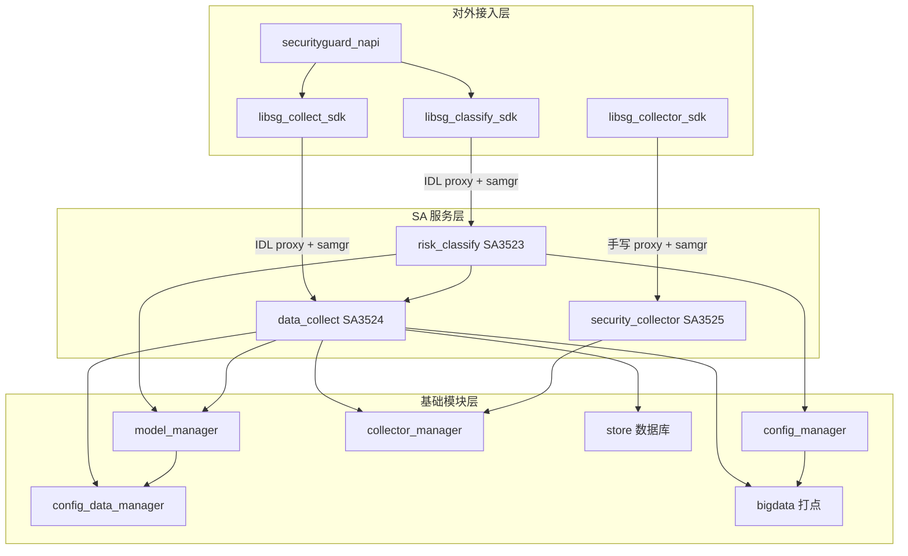

# 软件实现设计说明书 (SDD) 模板

> **使用指南**
> - 使用简洁、明确的语言
> - 重点关注模块间的依赖关系和约束
> - 记录重要的架构决策及其理由
> - 保持文档与代码同步更新

---

## 文档元数据
```yaml
document:
  type: "软件实现设计说明书"
  project: "security_guard（设备风险管理平台 SecurityGuard / SG）"
  desc: "OpenHarmony security 子系统下的设备风险管理平台，统一承接安全事件上报、订阅、查询与入库，管理采集器与风险分析模型，并提供 AuthEvent 阻断框架（Client/Provider 分离、从严聚合）"

【可选】appendix_ref:
  detailed_modules: "软件实现设计说明书-附录A-详细模块定义"
  adr_records: "软件实现设计说明书-附录B-架构决策记录"
```

> **说明：** 文档元数据用于快速识别文档的基本信息。`appendix_ref` 可选字段用于引用更详细的附录文档，当主文档过于冗长时，可将详细内容拆分到附录中。

---

# 目录

> **说明：** 目录采用JSON格式，便于工具解析和自动化处理。`range` 字段表示章节的行号范围，当文档内容更新时需要同步更新这些值。

```json
{
  "document": {
    "file": "software_architecture.md",
    "totalLines": 295,
    "structure": [
      {
        "section": "文档元数据",
        "range": [1, 25]
      },
      {
        "section": "系统概览",
        "range": [75, 125],
        "subsections": [
          {"name": "系统定位", "range": [79, 95]},
          {"name": "系统边界", "range": [97, 110]},
          {"name": "上下游关系", "range": [112, 125]}
        ]
      },
      {
        "section": "模块清单",
        "range": [127, 214],
        "subsections": [
          {"name": "模块职责表", "range": [139, 159]},
          {"name": "模块依赖关系", "range": [161, 214]}
        ]
      },
      {
        "section": "架构原则",
        "range": [216, 277],
        "subsections": [
          {"name": "核心设计原则", "range": [220, 250]},
          {"name": "反模式禁令", "range": [252, 277]}
        ]
      },
      {
        "section": "术语解释",
        "range": [279, 295]
      }
    ]
  }
}
```

## 1 系统概览

> **说明：** 系统概览部分帮助AI Agent快速理解系统的定位、边界和外部依赖关系。这些信息对于理解代码变更的影响范围至关重要。

### 1.1 系统定位

```markdown
**系统名称**: security_guard（SecurityGuard / SG）

**一句话描述**: 设备风险管理平台，统一承接安全事件上报/订阅/查询/入库、采集器管理、风险模型分析与阻断事件协调。

**所属领域**: 系统安全 / 设备风险管理（OpenHarmony security 子系统，SystemCapability.Security.SecurityGuard）

**核心价值**:
1. 统一安全事件通道：上报、sqlite 入库、订阅分发与多路查询；
2. 可插拔风险分析：模型 so 与检测插件运行时加载，OEM 可扩展；
3. 标准化阻断框架：AuthEvent Client/Provider 分离接入，框架侧只做路由与从严聚合，阻断结果走 HA 打点上报。
```

> **说明：** 明确系统的边界有助于AI Agent判断某个功能是否应该在本系统中实现，避免职责不清导致的代码混乱。


### 1.2 系统边界

```yaml
boundaries:
  includes:
    - "{{包含的功能范围1}}"
    - "{{包含的功能范围2}}"

  excludes:
    - "{{明确排除的内容1}}"
    - "{{明确排除的内容2}}"
```

> **说明：** 上下游关系描述了系统与外部系统的交互方式。AI Agent在修改接口或数据结构时，需要考虑对上下游系统的影响。

### 1.3 上下游关系

```yaml
upstream:
  - system: "{{上游系统}}"
    integration: "{{集成方式}}"
    purpose: "{{用途}}"

downstream:
  - system: "{{下游系统}}"
    integration: "{{集成方式}}"
    purpose: "{{用途}}"
```
---

## 2 模块清单

> **说明：** 模块清单是SDD的核心内容，它定义了系统的模块划分、职责和依赖关系。AI Agent通过这部分信息可以：
> - 理解代码的组织结构
> - 判断新功能应该放在哪个模块
> - 避免违反模块依赖规则
> - 理解模块间的协作关系
> - 当一个目录下代码文件超过10个，理应作为一个独立模块看待，并于模块概览中单独列举
> 

> **说明：** 模块职责表以表格形式汇总所有模块的核心职责，便于快速查阅。`category` 字段帮助区分业务模块、技术模块和共享模块。

### 2.1 模块职责表

| 模块名 | 职责 | 类别 | 相对路径 |
|-------------|-----------------------------|--------------|-------|
| risk_classify（SA 3523） | 风险分析模型管理：模型 so 生命周期、检测插件加载与事件分发、模型结果请求 | 业务 | services/risk_classify |
| data_collect（SA 3524） | 安全事件上报/入库/订阅/查询、配置更新、AuthEvent 阻断框架（AuthCoordinator 路由与从严聚合） | 业务 | services/data_collect |
| security_collector（SA 3525） | 采集器事件订阅/退订、采集器启停与事件查询（手写 Stub/Proxy） | 业务 | services/security_collector |
| collector_manager | 按 security_audit.cfg 清单 dlopen 采集器 so 并调用 ICollector 插件接口 | 基础能力 | services/collector_manager |
| config_manager | 事件/模型/事件组/信任列表配置的加载、缓存与更新（含 config_data_manager 进程内配置缓存） | 基础能力 | services/config_manager |
| data_collect/store | sqlite 封装与风险事件 RDB 存储（sg_collect_service_database） | 基础能力 | services/data_collect/store |
| bigdata | HiSysEvent 打点统一出口（域 SECURITY_GUARD，9 个事件） | 基础能力 | services/bigdata |
| libsg_classify_sdk | 风险模型结果请求 C/C++ SDK 与 IDL proxy | 对外 SDK | frameworks/common/classify |
| libsg_collect_sdk | 事件上报/订阅/查询 SDK、AuthEvent/AuthProvider 会话式 SDK、事件过滤与上报区域管控 | 对外 SDK | frameworks/common/collect |
| libsg_collector_sdk | 采集器管理 SDK 与 ICollector 插件接口（OEM 采集器 so 实现） | 对外 SDK | frameworks/common/collector |
| securityguard_napi | JS API（security.securityGuard：采集启停、事件上报/查询、阻断 Provider 等） | 对外 SDK | frameworks/js/napi |
| common 基础库 | utils/constants/json/log 共享工具、常量与错误码 | 工具 | frameworks/common/{utils,constants,json,log} |
| inner_api 头文件 | 对外契约头文件（classify/collect/collector/common） | 契约 | interfaces/inner_api |

> → 附录A: 详细模块定义

> **说明：** Mermaid图直观展示模块间的依赖关系，`dependency_rules` 定义了依赖约束规则。AI Agent在生成代码时必须遵守这些规则，否则会导致架构腐化。

### 2.2 模块依赖关系



```yaml
dependency_rules:
  - rule: "业务 SA 模块之间禁止互相依赖 so；现有唯一例外 risk_classify → data_collect"
    rationale: "避免 SA 间循环依赖与进程拉起耦合；新增服务间调用一律走 samgr + IPC"
  - rule: "外部进程只能经 inner_api SDK（proxy）访问服务，禁止直接链接或 dlopen 服务端 so"
    rationale: "保持进程边界，符号导出由 version_script 严格控制"
  - rule: "基础模块（collector_manager、config_manager、bigdata、store、frameworks/common）不得反向依赖业务 SA 模块"
    rationale: "依赖方向必须单向：接入层 → 服务层 → 基础模块层"
  - rule: "HiSysEvent 打点统一走 services/bigdata；阻断结果 HA 打点唯一例外走 IEventWrapper（dlopen sg_ext 的 libsg_event_wrapper.so）"
    rationale: "打点口径集中管控，避免散落调用导致统计漂移"
```

---

## 3 架构原则

> **说明：** 架构原则是系统设计的指导方针，AI Agent在生成代码时应该遵循这些原则。`priority` 字段表示原则的重要性（P0最高）。

### 3.1 核心设计原则

```yaml
design_principles:
  - principle: "进程与权限隔离"
    priority: "P0"
    description: "三个 SA 分进程承载：security_guard 进程承载 3523/3524，security_collector 进程承载 3525，按最小权限分配（COLLECT/QUERY/REPORT_SECURITY_EVENT）"
    application: "新能力归属先按权限最小化选定宿主 SA，再落模块"

  - principle: "单向依赖分层"
    priority: "P0"
    description: "接入层（NAPI/SDK）→ SA 服务层 → 基础模块层，禁止反向依赖"
    application: "新模块先定层级，再写 BUILD.gn 依赖"

  - principle: "框架不做业务决策"
    priority: "P0"
    description: "AuthEvent 阻断框架（AuthCoordinator）只做事件路由与从严聚合（任一 DENY 即阻断），决策由订阅 Client 回填"
    application: "新增决策方以 Client 身份接入，不往 AuthCoordinator 加业务逻辑"

  - principle: "配置驱动与运行时插拔"
    priority: "P1"
    description: "事件/模型/事件组/信任列表由 oem_property JSON 配置驱动；模型 so、检测插件、采集器 so、事件包装 so 运行时 dlopen"
    application: "新增事件/采集器优先扩配置与插件，不改核心代码"

  - principle: "编译开关隔离特性"
    priority: "P1"
    description: "特性开关集中在 security_guard.gni（如 security_guard_auth_event_enable 默认 false），特性代码用宏双重隔离"
    application: "非默认特性必须同时提供 gni 开关与 C 宏，保证默认产物不变"
```

> **说明：** 反模式禁令明确列出禁止使用的代码模式，AI Agent必须避免这些模式。`alternative` 字段提供了正确的替代方案。

### 3.2 反模式禁令

```yaml
anti_patterns:
  - pattern: "绕过 SDK 直接链接/dlopen 服务端 so，或引用服务端头文件私有实现"
    reason: "破坏进程边界与 version_script 符号导出控制"
    alternative: "经 interfaces/inner_api 的 SDK + samgr 获取远端调用"

  - pattern: "在 AuthCoordinator/SetAuthResult 等 framework 侧加入业务决策逻辑"
    reason: "决策职责属于订阅 Client，框架侧加逻辑会造成多决策方口径不一致"
    alternative: "新决策方按 Client 接入（AuthEventSubscribeClient + SetAuthResult）"

  - pattern: "在业务代码中散落 HiSysEventWrite 直接打点"
    reason: "打点口径漂移，事件定义与实现脱节"
    alternative: "统一经 services/bigdata 封装；阻断 HA 打点走 IEventWrapper"

  - pattern: "新增手写 IPC Stub/Proxy"
    reason: "手写易错且难维护（SA3525 手写为历史遗留）"
    alternative: "一律使用 IDL 工具（idl_gen_interface）生成"

  - pattern: "不加 gni 开关直接合入非默认特性代码"
    reason: "默认设备产物体积与行为被意外改变"
    alternative: "security_guard.gni 加开关 + 宏隔离，默认关闭"
```

---

## 4 术语解释

> **说明：** 术语解释部分用于定义文档中使用的专业术语或项目特有的概念，帮助读者理解文档内容。

| 术语 | 解释 |
|------|------|
| SG / SecurityGuard | 设备风险管理平台，本组件简称 |
| SA 3523 / 3524 / 3525 | 三个系统 Ability：risk_classify（风险分析）、data_collect（数据采集）、security_collector（采集器管理） |
| AuthEvent | 阻断事件（eventId/content/metadata/seqnum），定义于 interfaces/inner_api/collect/include/auth_event/auth_event.h |
| Client / Provider | 阻断框架两类接入方：Client 订阅阻断事件并回填决策；Provider 发起鉴权请求并接收聚合后的最终策略 |
| AuthCoordinator | SA 3524 内的阻断协调器，负责 serviceId 路由、超时管理与从严聚合 |
| 从严聚合 | EvaluateStrictPolicy：任一 Client 回 DENY 即阻断，全部 ALLOW 才放行 |
| EventCfg.serviceId | 事件配置中的阻断服务提供者标识，用于 Provider 匹配路由 |
| ICollector | 采集器插件接口，OEM 以 so 形式提供，由 collector_manager 按 security_audit.cfg dlopen |
| 检测插件（DetectPlugin） | risk_classify 按 detect_plugin.json 加载的检测能力插件 |
| HA 打点 | 经 sg_ext 仓 libsg_event_wrapper.so（IEventWrapper）的上报通道，如 AUTH_BLOCK_RESULT |
| HiSysEvent | OHOS 系统事件打点框架，本组件 domain 为 SECURITY_GUARD，出口集中在 services/bigdata |